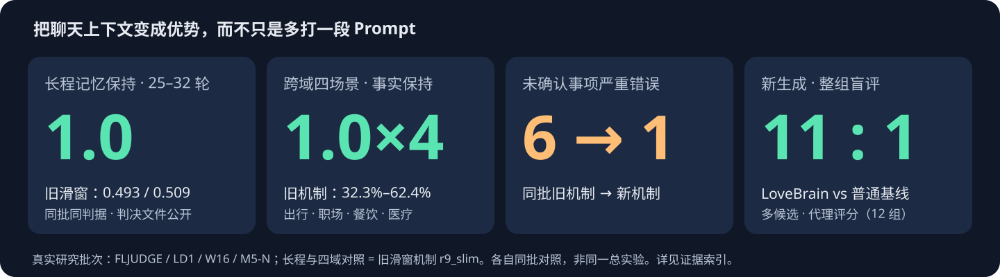
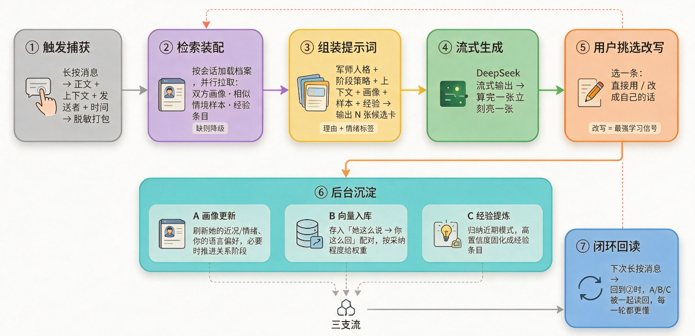
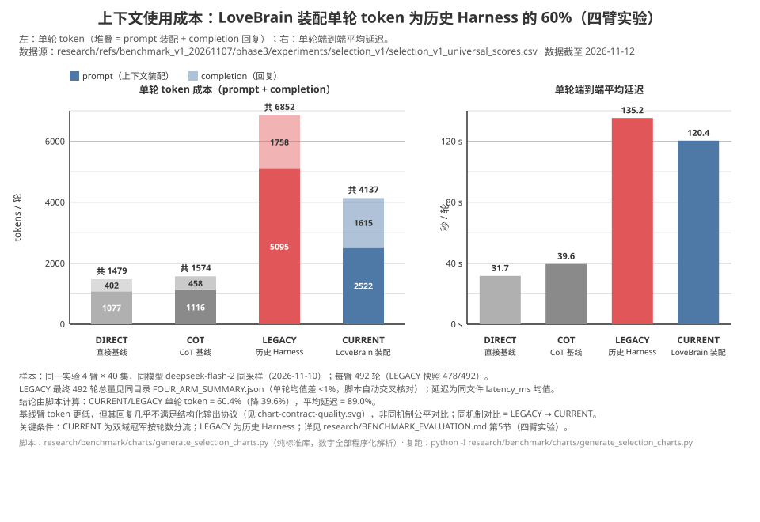

<div align="center">

<a href="images/demo-poster.png"></a>

<p align="center"><sub>▲ 悬浮面板与多风格候选生成演示（截帧备图，第 4 秒起出现候选卡；录制于 v1.3.x 旧版，界面已改版，动图待补录）</sub></p>

# LoveBrain

### 【槽：待 u258｜主口号（槽⑤）——v2 继承底座现句"不是替你回一句话，而是帮你把这段关系聊明白。"语义不可变、可润色；scout-64 硬约束随行：15–25 字、至少落一个语义位（优先「悬浮在聊天旁＋多候选供挑选」）、禁绝对化最高级与无凭据状态词、发送权立场必保、研究线数字不进口号】

在 25–32 轮长程对话测试中，长程事实保持率达到 **100%**——旧滑动窗口机制（改版前）同批同判据同一考试只剩 **49.3%/50.9%**（判决公开可查：[长剧记忆评测判决](research/refs/experiment_protocol_20261023/long_probe_20261030/FLJUDGE_VERDICT_20261102.md)）。对照＝改版前旧滑动窗口机制的历史版本（同批同判据父本），不是普通直答模型。

**记住很久以前的细节 · 不把猜测说成事实 · 一次给出真正不同的高情商回复。**

Android 悬浮 AI 聊天助手：贴在聊天界面旁，读懂上下文，帮你构思、对比、修改；**最后由你自己决定发什么，不会自动代聊或发送。**

关系记忆、知识库和聊天归档保存在你手机的 App 私有空间，系统云备份已关闭；生成时仅将本轮必要输入与相关记忆发送给你选择的服务商。

**[下载安装 APK（v1.4.2）](https://github.com/bystery/LoveBrain/releases/latest)** · [看真实聊天案例](#一个故事看懂-lovebrain) · [查看实验成绩](#这些优势是怎么测出来的) · [开源代码](app/) · [隐私与数据](#隐私与数据)

APK 安装需允许一次「未知来源」授权，Android 8.0+ 标准流程。


</div>



四项成绩来自四项独立研究批次，各自同批对照、非同一总实验。

[长剧记忆评测判决](research/refs/experiment_protocol_20261023/long_probe_20261030/FLJUDGE_VERDICT_20261102.md) · [跨场景记忆评测判决](research/refs/experiment_protocol_20261023/long_probe_20261030/LD1_VERDICT_20261102.md) · [无据坐实压测判决](research/refs/experiment_protocol_20261023/long_probe_20261030/W16_UNC_VERDICT_20261102.md) · [成本对照数据](research/benchmark/charts/charts-data.md)

> **成绩是做出来的，不是写在 Prompt 里的。** 四项成绩的原始判决与评分记录全部公开可查，见[证据索引](docs/appendix/EVIDENCE_INDEX.md)。

## 一个故事看懂 LoveBrain

这是项目里真正跑过的**合成聊天测试故事 E340「贝加尔湖畔的拍子」**（第 340 号测试故事），人物虚构、对话和下列输出均来自仓库现有实验，不是为 README 临时编造的成绩。

互怼一年的合唱团同事借声部互换递信号：她退-探头-回-进，12 轮拉扯，演出夜亲手重启馄饨摊之约，奶茶债首尾扣。

霍青崖和顾星晚是同团一年、互怼居多的合唱团同事，两人之间有着心照不宣的默契，却始终隔着一层没挑明的窗户纸。

故事里埋着很多只有认真跟过聊天的人才懂的伏笔：

- **起点**：她让他排练结束买奶茶，三分糖去冰；嘴上嫌他拍子，心里知道他唱得很稳。
- **后来**：她声带不舒服，他默默送了润喉糖；她选中独唱段，让他的低音和声接自己的高音，**由他给手势打拍，她台上只看他的手势**。
- **演出前**：她半开玩笑约夜宵，第二天又怕人多眼杂、被小莼写进群里而收回；随后却再次试探散场吃饭的地点。
- **终于**，演出前一天下午，她发来一句：

> **顾星晚：** 「明天演出。我哥高铁到了，我跟他说我有个特别稳的低音搭子，台上从来不抢拍。他问搭子是什么搭子，我没理他。」

这句话表面上只提了“搭子”，背后却藏着一次克制的关系试探：她主动把他介绍给哥哥，又不肯替两人的关系轻易下定义。

### 普通 AI 的实际回复

> **素材来源**：第 340 号合成测试故事（虚构人物、测试构造），输出均来自仓库真实实验运行。**对照身份**：普通基线＝单通道直出基线臂：无多候选机制（无风格槽、方向槽与结构守卫），按其自身完整配置原样参评；本轮为"两套完整候选组"的整组对比，条数不等、不齐不罚。**评委身份**：独立匿名评审＝原生子代理盲评（AI 评审，逐条引用原文判定）；非真人用户调查，不可称用户发送率。**匿名代号**：评审时双方身份匿名，判词中的 A/B 组为盲评代号；下文“多候选组／单条基线”为展示代称。

> 「你随口问的那家馆子我真去看过了，价便宜量又大，散伙饭都坐得下。散场夜宵你要是敢来，我就敢请。」（题面聊天记录第 10 轮 · 单条基线候选）

【槽：待 u232｜frag-p1 收口——本区已按 frag-p1c-reconcile 裁决预拼：旧 DIRECT T10 引句与旧"搭子悬置"点评句已删除（R4 禁跨线拼装、R5 点评越界收窄，事实结论"引句逐字属实"留档不灭）；翻车点一/二改挂本区。承接句与全块终稿措辞待 u232 收口复核。】问题出在事实边界上：聊天记录里她只是在打听饭馆，AI 却替男主编造了“我真去看过了”的未发生经历，因此这一条被直接判定为不可用。

**评委判词（该轮＝多候选整组盲评 12 对中的第 1 对；组级总偏好 11:1（12 对；本轮＝第 1 对），决胜维度白话＝零事实编造）：**

> 「其中'我真去看过了'是记录中不存在的已发生动作（第09轮只有她借小莼名义打听，无任何看店行为），属编造已发生动作的严重错误嫌疑，恰好污染她昨天还在打听、最可能想发的这条线」  
> ——首评判词逐字（[判分对复核件](research/evaluation/user_value_v1/m5-eval/npair2-01.json)；判词中"第09轮"指题面聊天记录第 9 轮）。

同一份判词也认定普通基线生成的 4 条回复中有 3 条可用，其中 1 条还拿到了最高自然度评价（“像真人随手打的话，可直接发”）；真正拉开差距的，是关键时刻是否会无中生有。

**翻车点一｜演出夜编营业时间（T11→T12 当场打脸）**

铺垫句，她 T11 原话（31 字，timeline.json index[12] 逐字）：

> 散伙饭我推了，就说家里有事。桥东那家馄饨摊，周日晚上还开着吗？

普通基线 T11 引句（干净轮免标注）：

> "开着，老板周日一般摆到十一点。我车停后巷，十分钟到你楼下，你只管下来，今晚我请。"

40 分钟后她查证回话（HER T12 首句截断，timeline.json index[13]）：

> 开着呢，我查过了，营业到凌晨一点半。……

事实内核：2026-11-29 是周日、她问的就是今晚；「摆到十一点」系编造营业时间，当场被打脸（时间理解错误＝事实错）。上一轮它说摊子『摆到十一点』，这一轮她查过是『凌晨一点半』——再下一轮，它的回复里只剩下她给的数字。

**翻车点二｜探头轮编店名＋重提已撤回的夜宵（T09）**

普通基线 T09 引句（干净轮免标注）：

> "散伙饭就去后巷老李砂锅，量足价低，一桌人两百出头能吃饱，跟小莼说一声就行。帽子的事我不问。夜宵那句我也没打算当没听见——散场我走北门，你看着来。"

失误内核：「后巷老李砂锅」是编造店名（知识库无此店，知识库只有"车常停活动中心后巷"）；她本轮明说"我随口问问的，你别上心"，该臂顺带重提她已整体撤回的夜宵、踩探头轮雷区。这一轮它编造了知识库里没有的“后巷老李砂锅”，又把她明说“你别上心”的夜宵重新端了上来——没影的店、收回的话，都被它当了真。

### 其他故事里的同类失误（副卡）

**副卡声明（事实锁定；措辞可润）：**

> 下一例来自**另一集合成测试故事**——观鸟线「沈疏桐×傅临川」（E341），与上文合唱团故事不是同一批人物、同一套设定。

**她那一轮的原话，逐字（episode.json 与该轮输入件双源一致）：**

> 赌约作废。所里年审名单今天下来了，接下来两个周六我全在所里，北湖你别等我，组里的活你多担着。咖啡债先挂着，回来再算。

——她 E341 T04 原话（合成故事第 T04 轮，2026-11-19 19:30；她明说"北湖你别等我"）。

**普通基线组的输出，逐字（单条基线第 4 条，双源同文）：**

> 行，两个周六的活我接了，北湖照走，七点集合不变。咖啡债挂着，跑不了，跟北湖的凤头䴙䴘一样，回来一起算。

**翻车表述（以评委逐字判词为锚，措辞待润）：**

> 基线把「七点集合不变」写成定局——而这一轮对话记录里从没有过七点集合的约定，评委判定「存在未定坐实嫌疑……不选它发」。

**评委判词原文，逐字：**

> 同组 item4『北湖照走，七点集合不变』存在未定坐实嫌疑（记录中无任何七点集合约定），不选它发。

——该候选是单条基线 4 条中唯一被标严重错误嫌疑者；多候选组 8 条候选全部无严重错误嫌疑。整组盲评：偏好多候选组（决胜维度 usable_distinction）；自然度 多候选组 5 / 单条基线 4，可发送性 多候选组 3 / 单条基线 2。

**副卡口径行（随引附带，事实面锁定，措辞待润）：**

> 本例口径：合成测试故事 E341 第 T04 轮；用户价值实验新生成线基线臂——固定模板单次生成 4 条候选、无机制装配（下文"普通基线组"沿全文匿名代号口径）；生成记录 fail_or_retry="ok"，非限流重试轮；机制臂同轮 8 条候选 0 污染、整组偏好胜出。

**LoveBrain 组同轮对照，逐字（同一判分对）：**

> 赌约是你提的，作废也是你一句的事，我那个'敢'字还没发出去，这局记你弃权。行，北湖两个周六我盯着，新人我带，咖啡债挂账，回来连本带利。

**换了故事、换了人物，单条基线在同一类地方栽同一类跟头；而多候选组在同轮拿出了干净得多的整组。**

### LoveBrain 完整机制的实际输出

以下四风格候选＋一条话题方向＝多候选产品能力（禁裁成单条）；候选全集 8 条（4 槽＋4 方向）见原始输出，本位展示 4＋1 其余折叠。

**首选 · 接住“什么搭子”的试探，把答案留到散场当面**

> 「明天'稳'字照旧。散了场，'什么搭子'的答案你亲自来听——先说好，这答案有点长，得配夜宵。」

**轻挑 · 轻轻点破她“没理他”背后的小心思**

> 「是怕他猜中才不理他的吧。没事，明天我一张嘴，'特别稳'三个字你都得嫌谦虚。」

**俏皮 · 顺势认领“特别稳的低音搭子”头衔**

> 「'特别稳的低音搭子'这头衔我认领了，明天下午正式营业。你哥再问就告诉他：限量款，团里就发了一个，不外借。」

**温柔 · 记着她看重这场演出，约定台上只管盯手势，台下低音托底**

> 「知道明天这场地在你心里的分量。台上你只管盯你那个手势，低音贴着你的高音走——真抖了，算我的。」

还能换一个真正不同的话题方向：

> 「先不聊搭子了——开演前我去买奶茶，三分糖去冰的规格我记着呢，你哥那份也带上，紧张就先喝半杯。」

这不是把一句话改写成四种同义句。**它给的是不同的关系姿态：接住、点破、玩笑、托底，以及能继续推进的话题。** 用户按当下的心情挑一句即可。

**同两轮，完整机制怎么答**——同样的两轮，它一处编了营业时间、一处编了店名；完整机制两处都不编。同一题，两种下场。

**T11（演出夜）**——不编时刻，只接她的问句＋行动落地＋回指收口：

> "稳住了就好，台侧那几下拍子没白踩。馄饨摊开着，我把车从后巷挪到桥东，你换完衣服到门口等我。"

（"台侧那几下拍子"＝双回指：第 6 轮手势约定＋第 7 轮被撤回的钩；"馄饨摊开着"只接她原话问句、不编时刻。）

**T09（散伙饭探头轮）**——只给品类不编店、接撤回不追问：

> "行，不上心。人多就找活动中心附近那种家常菜馆，量大价低，别挑门面。几个人？说个数，我按人头给你算人均。"

评分佐证：这条故事里完整机制 12 轮逐轮评分全部满分、零否决、结构与解析校验全过（案例层陈述）。

**落定轮·结尾对照位**

**她最后一句话，逐字（全句；翻车点一只引了首句）：**

> 开着呢，我查过了，营业到凌晨一点半。九点半桥东馄饨摊，我请，你欠我的那杯奶茶连夜宵一起结。家里要真来电话查岗你就算了，我一个人也能吃出两桌的热闹。

——她 E340 T12 原话（73 字），`benchmark/stories_v2/wave5_selection/E340/timeline.json` message_index[13]，ts 2026-11-29 23:05。"凌晨一点半"即对基线 T11 编造"摆到十一点"的当场查证推翻（与翻车点一同源，不算冲突）。

**LoveBrain 的回答，逐字：**

> 九点半早过了，现在十一点一刻。摊子开到一点半，来得及——我出门了，没人查岗。

——完整机制臂 E340 第 12 轮首选候选（38 字），"现在十一点一刻"与她 23:05 发话、臂侧 23:12 注入时钟自洽，非编时刻。

**同一句退路，两种走向（对照表，措辞待润）：**

| | 对她的退路句 | 对「我请」 | 对时刻 | 走向 |
| --- | --- | --- | --- | --- |
| LoveBrain | 条件核销："没人查岗"→照去 | 尊重"我请"，未抢付 | 九点半早过／十一点一刻／开到一点半 | **落定赴约**（奶茶债连夜宵一起结） |
| 普通 AI | 退路当默认，接走"你就算了" | "改天我请"倒转付账方 | 前轮刚被打脸，本轮照抄她的"一点半" | **改期悬置** |

**普通基线 T12 引句（限流重试轮，随引附标注；禁反向写成"基线被限流拖累"）：**

> "馄饨摊开到一点半，晚点去也赶得上。你要是被家里叫住就别硬撑，说一声，改天我请。"
> （基线该轮经限流重试成功后输出，非降级产物）

多候选佐证：同一轮完整机制另给出三条风格候选与话题方向（原始输出在册）：轻挑"查岗的电话没有，就你一个。九点半改成现在，你先去占座，我十分钟到。"／俏皮"一个人能吃出两桌的热闹，那我坐哪桌？都十一点一刻了，馄饨先给我留一碗，我这就来。"／温柔"没人查岗，我出门了。你先点一碗垫着，别在风里等我。"／方向"到了给你发消息，你挑靠里那桌坐。"等 3 实 1 空。

她留了退路，也留了账单。一边把退路核销掉、出门赴约；一边把退路当答案，约改到了『改天』。

尾注：「低音搭子」称呼线于本轮自然退场——第 6→10→11 轮三次接线后，第 12 轮全候选无一字提「搭子」，收口转馄饨摊。

【槽：待 u232｜R8 对称纪律披露块落位——同一判词对 LoveBrain 侧的记录不得删隐：①首评盘点曾把主回复记"严重错误嫌疑"（夜宵复活嫌疑），判词同段已认定"夜宵话头仅作散场答问的场景话引，属发送方主动提议，无事实虚构"；②复核件唯一记录项＝俏皮槽"明天下午正式营业"隐含断定演出时段，属次要级按锚点不判死。两侧同一判词管到底，禁只引对基线不利的半份；披露形态（details 块）待 u232 收口单元定稿。】

[阅读 E340 完整故事](research/benchmark/stories_v2/wave5_selection/E340/episode.json) · [这一题逐候选评分理由（复核件，8 条逐候选判定）](research/evaluation/user_value_v1/m5-eval/npair2-01.json) · [双方原始输出登记](research/evaluation/user_value_v1/outputs.jsonl)

这个故事的第 10 轮，本身就是后面 12 对整组盲评中的一对：这一轮的完整候选组被选中，12 对的总账是 11:1——E340 是其中 1 票，比较的始终是两套完整候选组，不是单条对单条。

### 更多真实跑过的故事

上面只是一条 12 轮的短故事。仓库里还有一批不同关系姿态的合成测试故事（人物均为虚构），下面**四**条的对话与回复全部是真实实验原始输出，可逐条点开核对。

#### 忙季边界：审计搭档的失联与修复（E308）

审计师姜宁预告忙季失联，领骑陆嘉仍做好路书给她留位；被她点名"这两周别单排我"后干净退出，两周后她主动回来修复。

> 姜宁："不是不想聊，是脑子里全是底稿。"
>
> 完整机制版回复："那两周的事你不用解释，我没催过，也没往心里去。"
>
> 普通单回复版回复："报告交了就先补觉，别的都往后放。"

一个接住了修复，一个跳过修复直奔安排——边界被尊重之后，关系怎么接回来，两种形态给出了不同答案。

[E308 完整故事](research/benchmark/stories_v2/wave4_dev/E308/episode.json) · [完整机制原始输出](research/experiments/runs/pilot2_all/CURRENT/E308/turn_11_E308_T11/reply_raw.txt) · [普通单回复原始输出](research/experiments/runs/pilot2_all/DIRECT/E308/turn_11_E308_T11/reply_raw.txt)

#### 同一情境，两种走向——「稳稳完赛这条路」×「改道破四这条路」

**同一情境，两种走向，各自走到了终点。**
这是测试库里的一组"孪生剧情"：同一段首马备战故事、人物换名，前三轮完全同骨架，从第 4 轮报目标那一刻分岔——一条线里她顶住怂恿、稳稳完赛，最后 5:26 安全完赛兑现；另一条线里她接住野心、改道破四，最后 3:57:42 破四兑现。两段剧情里的助手各接住了一种决定：不泼冷水，也不陪着上头。

**第 4 轮（分叉轮）她的话，两臂逐字：**

> **「稳稳完赛这条路」第 4 轮（覃念北）：**
> 「老驰在群里让每人报目标，好分组排课表。他上周还让我拉了个 10 公里计时，49 分 40，群里都说我底子好。不过我想了两天还是那句话：首马就求稳，我报了安全完赛，关门内稳稳走完就行。课表应该不用动吧？」
>
> **「改道破四这条路」第 4 轮（陶栀夏）：**
> 「老驰在群里让每人报目标，好分组排课表。他上周还让我拉了个 10 公里计时，49 分 40，昨天又私聊说我这个跑量和步频的底子，破四有戏。我想了一晚上，改主意了：目标从安全完赛改成破四，3 小时 59 分以内。课表是不是得推倒重排？」

分叉只在一个决定：同一个 49 分 40，一个选择"不动"，一个选择"改道"。

**助手的回复（两线同轮均评满分 10.0，逐字）：**

> 稳完赛线：「课表不动。10 公里 49 分 40 说明你底子好，但首马看的是月跑量和耐力，不是 10 公里速度。报目标就按安全完赛报，别让这个成绩把你分进快组，跟着快组容易上头。想了两天没改口，说明你是真想清楚了。」
> 破四线：「49分40不虚，底子是真有。但课表别推倒重排——离比赛就剩20天，重排也长不出新体能，能动的只有配速和最后两周的减量。框架留着，配速和减量我来调。先问一句：那趟10公里是全力跑的吗？」

**一句话解释：** 同一个起点、同一个数据、两种选择——两条剧情各自兑现了自己的目标。展示的是"策略跟着对方的真实决定走"，不是"哪条路更好"。

[稳完赛故事档案](research/benchmark/stories_v2/wave5_selection/E375/episode.json) · [破四故事档案](research/benchmark/stories_v2/wave5_selection/E376/episode.json) · [稳完赛第 4 轮原始输出](research/experiments/runs/selection_v1/CURRENT/E375/turn_04_E375_T04/reply_raw.txt) · [破四第 4 轮原始输出](research/experiments/runs/selection_v1/CURRENT/E376/turn_04_E376_T04/reply_raw.txt)

<details>
<summary>这对孪生剧情的逐字记录</summary>

- **代号对照：**「稳稳完赛这条路」＝E375（twin_role=original，全名「滨江首马：稳稳完赛这条路」，HER 覃念北 × ME 缪长青）；「改道破四这条路」＝E376（twin_role=counterfactual，全名「滨江首马：改道破四这条路」，HER 陶栀夏 × ME 倪山月）；同属 lineage_group_id=LG-T10-G3（twin_group=T10-G3）。exposure.json 无 seed 字段——**这不是"不同种子重跑"，是同骨架剧情、人物换名、第 4 轮单变量分叉的设计对照**。
- **T01–T03 三轮在人物名归一后逐字相同；T04 起分叉**（T04–T08 为扰动链差异位，T09/T10/T11/T12 卡面逐字段对称——E376 audit.md 原话口径）。
- **破四线另一臂全文（第 4 轮，逐字）：**「破四不是拍脑袋，但也不是没影——10 公里 49 分 40，底子是有的。可月跑量 80、离 11 月 29 号只剩 20 天，这会儿把课表推倒重排来不及，硬加量只会把自己跑伤。⏎课表不推翻，改三处：长距离照走；每周加一次 8 到 10 公里的马配，5:40 上下；赛前两周开始减量。⏎目标定成 A 破四、B 安全完赛。比赛前 30 公里按 5:50 压着跑，别一出发就冲，最后 12 公里再看状态。⏎先回我一句：你到现在最长一次跑过多少公里？」（"⏎"＝原文换行；[原始输出](research/experiments/runs/selection_v1/DIRECT/E376/turn_04_E376_T04/reply_raw.txt)）
- **机制花絮：** 上条"目标定成 A 破四、B 安全完赛"复述旧目标口径时，守卫原子真实开火：`{"atom": "E376_T04_A01", "kind": "cancel_affirm", "marker": "安全完赛"}`（评分表 guard_events 逐字）——参考卡的更正链在分叉轮有真实开火记录，契约校验 OK、无否决。
- **破四线候选池位（机制实验另一条线，仅代号层）：** E376_T04＝D60-010，在 24 位多候选池实验（rp1_b15）内，是全池唯一 chosen=playful 的固定首选位：四路候选 natural 157 / playful 117 / warm 133 / direct 145 字，三条超 120 字门禁被拦，唯一达标的 playful 被选中（「老驰这饼画得挺香啊哈哈。行，破四我陪你试，但先说好：20天不够重排课表，只够微调。10公里49分40确实够看，可全马拼的是月跑量，你80公里的底子后半程容易掉。这么定——目标写破四，心里留个后手：30公里感觉不对就转完赛，两头都不亏。」117 字，距上限 3 字符；门禁记录逐字：`multicast;chosen=playful;natural:FAIL(too_long);playful:PASS;warm:FAIL(too_long);direct:FAIL(too_long)`）。
  - **19:5:0 与本位（三限定整组随行，缺一即违规）：** E376_T04=D60-010 计入池实验总账 19 胜 5 平 0 负，但其单票是胜是平**不可从落盘重算**（96 条亲读分未落盘，FAILURE_ANALYSIS.md:515）；跨审计校准差 ±0.1–0.2（现评 vs 冻结）；b15 家族判决已降 **PROVISIONAL**。该数字只进 details 与证据索引，**故事库可见区不放**。
  - **门禁归因：** "chosen=playful"是 120 字门禁强制（四路三条超长、池剩 1 条），任何"+0.4 更好"归门禁不归选择器（原记录已自拆，rc02 §4.2）；**禁写"AI 四选一挑得俏皮/选择器眼光好"**。
  - **两组长度数字禁混用：** 上记 157/117/133/145 属 24 位池那次生成；另一批 12 位重跑（b15b）里 playful 121 字超限、warm 114 幸存（warm 4.8 vs natural 4.4=+0.4）——**两次生成、两批数字，禁互串**。
- **评分与覆盖口径：** 两集评分表各 24 行（12 轮 × 2 臂）；输出目录四臂齐全但评分仅两臂有行（2/4）——**"四臂对照"话术对这两集不成立**。
- **批次与实验身份：** 孪生对照属 wave5 标注线（selection_v1 计分对照）；与 24 位池实验（rp1_b15，D60 系列）是**两个实验，共用剧情、禁混写成一个**；E375 不在池内，"孪生两臂同池"不存在。孪生系全库共 4 组并存，本组独特点＝唯一完成结构逐轮核验并带池实验位的组。

</details>

#### 更长的对话跑过吗？跑过（E374，24 轮）

**更长的对话跑过吗？跑过。** 上面这条合唱团故事是 12 轮；另一条 24 轮、跨 36 天的志愿搭档故事里，第 18 轮完整机制主动翻出十二轮前的旧账——「你欠冯荻那班，跟着闭馆一起取消了，那还算不算还过？」——下一轮对方果然来兑现改期；末轮把七小时志愿时长一笔笔对上账收口。这条故事同样逐轮严格评分满分、零否决，原文全部可查。

<details>
<summary>这条 24 轮故事的逐字记录</summary>

- 欠账起因（第 6 轮，她的原话）：
  > 太好了，帮我谢过她。那 11-14 就记她名下，我欠她一次，下个月她的班我顶一次抵，这事你跟我一起记着，就这些。
- 跨 12 轮主动预警（第 18 轮，完整机制输出）：
  > 串词先别扔，改期了照样能用。倒是你欠冯荻那班，跟着闭馆一起取消了，那还算不算还过？回头跟郑老师要个准话，别到时候又记你头上。
- 下一轮她自己兑现（第 19 轮，她的原话）：
  > 我欠冯荻的班挪到 12-19 周六下午，表上登记了
- 末轮对账收口（第 24 轮，完整机制输出）：
  > 七小时对得上，两个晚班五小时，加带教两小时，郑老师这本账没记错。12-12 上午我早点到，最后一排就最后一排，不打瞌睡。
- 机制与评分：完整机制臂（window_expand_b_norecap_guard）24 轮逐轮评分全 10.0、零否决（[逐轮评分表](research/experiments/runs/selection_v1/universal_scores_guardv2.csv)）。
- 原文：[故事档案](research/benchmark/stories_v2/wave5_selection/E374/episode.json) · [第 18 轮原始输出](research/experiments/runs/selection_v1/CURRENT/E374/turn_18_E374_T18/reply_raw.txt) · [第 24 轮原始输出](research/experiments/runs/selection_v1/CURRENT/E374/turn_24_E374_T24/reply_raw.txt)

</details>


#### 三本账的对账夜话：她要一笔一笔归月份，单条全对，还是有得选？（E373）

夫妻对账夜话：她一口气报出七笔账、要求逐笔归进 10 月与 11 月——一条消息里埋着七处钩子：改口作废的 3286、长得太像的 392 与 329、跨月的 588、待冲抵的结转 33、已两清的 800、要单列的垫付 966，还有"月账对平再封存、封了不改"的家规。

> 当晚 20:50 她报账："我今天把三本账拢了拢，你帮我对个数：日常 3200、水电 392、车位 329、宽带 720、人情 1456、你垫的车保养 512、住宿垫付 966。"
>
> 20:54 她补上关键一句："重点是月份：这几笔里哪些算 10 月、哪些算 11 月，你一笔一笔归给我。"

**同一条消息，两种形态：**

| 单条基线（1 条） | 完整机制（8 条候选：4 条风格候选＋4 条方向候选） |
| --- | --- |
| "归好了，一笔一笔给你：算 10 月的五笔——日常 3200（按你改口后的新数为准，3286 作废）、水电 392（备注：含 9 月结转过来的 33，11 月补缴时冲抵）、车位 329、人情 1456（表姐那 800 按你标的已回礼两清）、车保养 512（我走前垫的），合计 5889；算 11 月的两笔——宽带 720（5 号续的年费）、住宿垫付 966（照旧单列，走单位报销，不进三本账）。另外你记的没错：392 是水电燃气，329 才是车位管理费，没混。双 11 那单 588 也是 11 月的，到时并进 11 月日常，你之前算得对。" | 首选风格候选："归好了，全按你报的数，一笔没动：10 月五笔——日常 3200、水电 392、车位 329、人情 1456、我垫的车保养 512，小计 5889；11 月两笔——宽带 720、我垫的住宿 966，小计 1686。水电 392 里含 9 月结转的 33 我也备注了，11 月补缴时冲抵。" 另有俏皮候选（含"月底对平咱就封存，封了不改，规矩我懂"）等 3 条风格候选＋4 条方向候选。其余两条风格候选原文同样在册、一字未改：温柔候选先说"这十来天小票都是你一个人铺开对的，辛苦了"；调侃盯防候选接住她怕抄错的那两笔——"就是 392 和 329 这对双胞胎，我帮你盯着，别再让它们串门。" |

**两列瑕疵成对标注（C2，缺一即返工）：**

- 完整机制列：966 计入"11 月两笔"小计 1686——按她的口径应单列垫付台账（她 11-11 原话："这笔走你单位报销，我先记进家庭垫付台账单列，不跟三本账混"）；归月清单七项中六项正确（10 月五笔＋11 月宽带 720）。
- 单条基线列：漏"封了不改"家规——这条规矩来自知识库双方设定段，不在当晚 9 条聊天消息内；钩子覆盖 6/7，是全部候选中唯一明示"3286 作废"的一条，零编造、零事实错误，966 单列括注保住。

四条方向候选里，收尾确认向的一条同时接住两处挂起事项："七笔归完，剩下的就是 11 月补缴冲抵那 33，和月底对平封存了吧？"——方向候选（收尾确认向），不是主答案。

**评委怎么看这一轮：** 独立匿名 AI 评审（原生子代理盲评，评审时双方身份匿名）整组判定：多候选组胜出，自然度 5:4、可发送性 3:2，六项子指标全过——该轮成绩为盲评代理评分，不代表真人用户发送率。胜因判词截录（完整判词原文见下方展开体）：

> ……在此之上还把她此前「这两个数长得太像，我怕后面抄错」的真实担心变成一条可直接挑中发送的区别化选项；四条候选语气彼此可辨、四个方向（收尾/留底/情绪/换题）均可用，单条基线仅单条无挑选余地——胜因是区别化选项真实可用，并非候选更多。

判词原文中"已完整归月""逐笔归月完整、月份归类全部正确"等评语，系盲评未下发 966 判据清单时的盲区产物——与本题判据"住宿垫付 966 单列、不走三本账"冲突，不构成本条 966 口径的背书；可见层截录已避开该段，截录行为如实标注；上方两列瑕疵标注与胜绩引用同页并存，胜绩不藏、瑕疵不辩。

这一轮的价值不在单条完美，在"有得选"：要盯防孪生数字有调侃盯防候选、要收尾对平封存有方向候选、要逐笔对全账则对照单条最全——单条逐笔全对与多候选宽度覆盖，两种形态各立其强项。单条把账对完就收口；多候选则在对完之后还留出挑选的余地：语气可挑、下一步可挑，连"账先放着"岔开话题也可挑——发哪一条，由她定。

口径行：本条目属用户新生成案例盲评批的一轮双臂对照（E373 第 9 轮）——多候选侧为知识库注入修复后的完整机制配置输出，单条基线侧为同题冻结产出原样复用；本条目同时是新生成案例 12 对组级盲评对照中的一对，该轮组级偏好多候选组胜出。对照两侧的评分方均为独立匿名评审＝原生子代理盲评（AI 评审，逐条引用原文判定），判分对象仅为匿名文本、评审时双方身份匿名，比较的是哪一组更值得用户挑选；非真人用户调查，该轮成绩为盲评代理评分，不代表真人用户发送率。

[E373 完整故事](research/benchmark/stories_v2/wave5_selection/E373/episode.json) · [这一轮逐对判分件（含完整判词）](research/evaluation/user_value_v1/m5-eval/npair2-03.json) · [冻结案例卡](research/evaluation/user_value_v1/cases.jsonl) · [产出登记](research/evaluation/user_value_v1/outputs.jsonl)

<details>
<summary>展开 E373 完整判词原文与对账细节</summary>

- 完整判词原文（逐字，含盲区段；评审时双方身份匿名，A/B 为盲评代号）：「就是 392 和 329 这对双胞胎，我帮你盯着，别再让它们串门。」——A 组（评审盲称，即多候选组）的 recommended（评委所称组内主推条）已完整归月（「10 月五笔……小计 5889；11 月两笔……小计 1686」），在此之上还把她此前「这两个数长得太像，我怕后面抄错」的真实担心变成一条可直接挑中发送的区别化选项；四条候选语气彼此可辨、四个方向（收尾/留底/情绪/换题）均可用，B 组（即单条基线）仅单条无挑选余地——胜因是区别化选项真实可用，并非候选更多。
- 盲区段说明：「已完整归月……小计 1686」一段系盲评未下发 966 判据清单的盲区产物；1686 把 966 计入三本账小计，正是上文完整机制列被标注的瑕疵——该数只随判词原文与瑕疵注出现，不作正确算式单独展示。
- "封了不改"两层来源注（C10）：家规原话在知识库双方设定段——"家里的规矩是月账对平后再封存，封了不改。"，不在当晚 9 条聊天消息内（9 条消息无一提封存）；俏皮候选的封存句与设定段逐字吻合，单条基线全文未提封存。
- 已复核算式（沿用事实核查件已复核集，不新造）：5889=3200+392+329+1456+512；1686=720+966；392=217+175；1456=800+388+268；588=150+438；3286−86=3200。

</details>

## 为什么它不是“套了一段更长的 Prompt”？

普通回复工具的任务是：“根据这段话，写一句回复。”

LoveBrain 要处理的是真实聊天里的连续状态。它有三层协同机制：

上面合唱团故事里，“奶茶三分糖去冰”和“谁在台侧打手势”之所以没有聊丢，又不把没去过的饭馆说成去过，靠的就是下面这套机制。

| 聊天里真正的难事 | LoveBrain 做了什么 | 最终帮你得到什么 |
| --- | --- | --- |
| **聊太久，早期细节丢了** | 只把确认的真实聊天事件写入长期上下文，按完整消息保留历史证据、选择当下有用的记忆 | 记得旧伏笔，不会把两个人的设定聊丢 |
| **事情改了、没定，却被 AI 说死** | 识别旧约定失效、未确认事项和私人备注；按当前话题组织约束，必要时阻止无据坐实 | 不会轻易替你订票、承诺、确认关系或泄露心里话 |
| **一句回复没错，却不是我想发的** | 分开生成首选、不同风格和可选话题方向；用确定性守卫保证输出结构 | 你有真正不同的沟通策略，而不是只有一条客服式标准答案 |

| 前面故事里的证据 | 靠的机制 |
| --- | --- |
| 奶茶债第 1 轮立、第 12 轮回扣；手势约定第 6 轮→第 11 轮兑现；"低音搭子"称呼第 6→10→11 轮接线；第 12 轮分析层双挂账机读回扣：「2026-11-29 桥东馄饨摊夜宵·进行中」＋「2026-11-13 奶茶·进行中（连夜宵一起结）」 | 记忆（证据流整条保留、只入用户确认消息） |
| 夜宵钩第 7 轮→第 8 轮整体撤回→第 9 轮挂起→第 11 轮重启；禁声第 4 轮→第 6 轮声带续管 | 状态与关系画像（跨轮追踪；旧目标被改主意后不再当话题） |
| 每轮四风格候选＋话题方向（上面四候选小节即此） | 多候选生成（四风格槽，非同义句） |
| 第 9 轮不编店名、第 11 轮不编营业时间；第 10 轮接称呼不定义关系（gold 坐实判负） | 事实边界（不无据坐实；注：该能力分域生效——未定事项块仅 25 轮以上剧情注入，12 轮故事未注入，本故事边界表现挂判分口径与分析层约束） |

旧伏笔进得了上下文，编造出不了结构。

关键消息只有你真正发出过才入账，历史按整条消息回给模型，不切半句、不做摘要改写。

<details>
<summary>记忆机制佐证</summary>

- 聊天软件默认"最近优先"，翻旧的就不见了；LoveBrain 把关键消息单独存成"证据流"：只有**用户真正确认发送过**的消息才入库，模型自己生成的回复只是草稿、永不入账（"模型说过一句话≠用户真的发过"）。需要历史时从最新一条往前按整条消息装满 3600 字符预算——不切半句、不做摘要改写。30 轮前说的金额、日期能原样回到模型眼前；对照实验长程保持率 1.0，滑窗约 0.5。
- 佐证：`EventHistoryAssembler.kt:25`（MAX_EVENT_HISTORY_CU=3600）／`:45`；`ChampionEvent.kt:146`（requireRealRole 草稿拒入库）；`ChampionEngine.kt:310`（commitConfirmedTurn 唯一入库路径）；CORE_MECHANISMS.md:98-100/124-125。**状态：LIVE**（PromptBuilder.kt:272 两域均注入历史块）。接线口径：LIVE_AUTO 默认档＝closeout-20261106 产品分支事实；research-migration-20261112 的 app/ 无此接线、默认 OFF。

</details>

悬着的事各记状态，没落实的话只以原话逐字挂进“未定事项”，不替你把猜测说成既成事实。

<details>
<summary>边界机制佐证</summary>

- **状态与关系画像**：每件"悬着的事"记状态：进行中/冷却挂起/完成/取消，再推当前场景和意图；旧目标被改主意或纠正后就不再当话题——存储里有，不代表本轮该用。佐证：`OngoingContextSelector.kt:50-54`（四态枚举）／`:129-130`（DORMANT 推导）／`:407/:425`（冷却）；`TopicSwitchGate.kt:50`；`CurrentSceneInjection.kt:22`、`IntentIdeaBlock.kt:27`。**状态：LIVE（产品原生件）**。
- **事实边界（不把没答应的当已约）**："周五可能有空""他好像答应了"这类没落实的话被单独挑出做成"未定事项"小块贴进输入：只用原话逐字引用、不改写，最多 3 条、120 字符；明确确认就关闭，与本轮无关的不放。没有未定事项时整块完全不出现，提示词与原来一字不差。佐证：`UncertainBlockDetector.kt:23-24`（120 CU/3 条）／`:183`（findUncertain）／`:224`（buildBlock）；arena 侧 uncertain_rules.py（CORE_MECHANISMS.md:154）。**状态：LIVE（分域）**——仅 ≥25 轮（UC_LONG）注入，≤24 轮恒空（`ChampionEngine.kt:73` 分域；W16 判决 severe 亲读 1 vs 6，触发面 29.2%）。

</details>

> **守卫保证每一次都有能用的回复。** 另一条 12 轮测试剧情里，有一轮对方犹豫退赛又自己收回，最后说"算了，你先别接话，我再说道说道"。同一轮、同一协议（该轮不允许免回复）下：旧版机制选择"免回复"，四个风格候选全部留空，这一轮用户什么都拿不到，也被确定性计分器按输出契约一票否决（0 分）；完整机制同样服从了"先不接话"——首选槽逐字"成，我先不接。你说。"——但四个候选槽全部交付，随时可发。其余 11 轮两版完全打平，0.83 的总分差全部来自这一轮。

<details>
<summary>这一轮的逐字输出与评分</summary>

**协议前提与用户原话（完整不剪辑）**
- 该轮输入 `"may_decline": false`（不允许免回复；episode.json turns[2] 实核）。
- 用户原话逐字（`research/benchmark/stories_v2/wave5_selection/E355/episode.json` turns[2].input.messages[0].text）：
  > "今天八公里，拉爆了。不是累的，是膝盖，下楼都打软。我挂了周一上午的运动医学科。要不元旦那个报名退了算了？……算了，你先别接话，我再说道说道。"
- 动机备注：她是犹豫退赛后**自己收回**退赛，不是单纯刁难助手；断章成"她让你闭嘴"会讲歪动机。

**旧版机制臂（LEGACY / legacy_compat_r9）同轮输出逐字**（reply_raw.txt 实核：action=no_reply、四槽全空、directions 全 null）
`research/experiments/runs/selection_v1/LEGACY/E355/turn_03_E355_T03/reply_raw.txt` 全文逐字：
```json
{"action":"no_reply","decline_reason":"她明确让我先别接话，状态低落，此刻安静等她自己说完更合适。","response":{"recommended":"","bad_boy":"","playful":"","warm":""},"directions":[null,null,null,null],"analysis":{...facts/tentatives 正常，updates:[]}}
```
- decline_reason 人读层面体贴，不贬低其人情判断（对照身份红线）；交付事实＝四个风格槽全空、directions 全 null。
- 同目录 `scoring.json`：`"score10": 0.0, "veto": "unauthorized_no_reply"`；唯一失败 check=`json_schema_valid`（输出契约：单 JSON，style_keys 非空≥1，directions=4，含 analysis，pts 2，got 0，pass false）——整轮 0 分。
- 机制侧旁证 `mechanism_notes.txt`：signal_hint=暂缓、action=收尾、`reply_not_committed=1`。

**完整机制臂（CURRENT / window_expand_b_norecap_guard）同轮输出逐字**（四槽逐字、3 条非空方向、score10=10.0）
`research/experiments/runs/selection_v1/CURRENT/E355/turn_03_E355_T03/reply_raw.txt` 关键段逐字：
```json
{"response":{"recommended":"成，我先不接。你说。","bad_boy":"行，我嘴闭上。退不退先放着，你先把话说完。","playful":"行，我闭嘴。单杠二十分钟那笔账我先记着，等你说完再算。","warm":"嗯，我听着。你慢慢说。"},"directions":["周一上午几点？我看看能不能陪你去。","八公里是你自己加的，还是本来就在计划里？","跑不跑都行，我就怕你下楼打软还硬撑。",null],"analysis":{...scene_facts 三条 source_ids 正常...}}
```
- 同目录 `scoring.json`：6/6 全过（json_schema_valid / source_ids_exist / ai_flavor / style_diversity max=0.20），**10.0**。
- 对照事实：她要"别接话"，完整机制用**内容**表达服从，**结构**上四槽非空可交付。

**12 轮差异分布（逐轮实测）**

| 轮 | T01 | T02 | **T03** | T04 | T05 | T06 | T07 | T08 | T09 | T10 | T11 | T12 |
|---|---|---|---|---|---|---|---|---|---|---|---|---|
| 完整机制（CURRENT） | 10 | 10 | **10** | 10 | 10 | 10 | 10 | 10 | 10 | 10 | 10 | 10 |
| 旧版机制（LEGACY） | 10 | 10 | **0 (veto)** | 10 | 10 | 10 | 10 | 10 | 10 | 10 | 10 | 10 |

- 均分：LEGACY 9.17＝(11×10+0)/12，CURRENT 10.0；总差 0.83 全部来自 T03 veto。

**结构守卫佐证映射（details 层）**

模型必须回 JSON（analysis＋4 条回复＋4 条建议方向）。流式期间边收边解析；收完后若有结构小错（多余围栏、弯引号、键写错、缺槽），由一段确定性代码只修结构不编内容：缺槽补 null 不虚构、方向多截 4 少补 null、修不动就原文直通。守卫改了文会先发重置事件再展示，界面与最终结果一致。佐证：`GenerationEngine.kt:394`（parseReplyResponse）／`:237`（增量解析）；`ContractGuard.kt:45/:784`（repairAndAudit）／`:28`（截 4 补 null）；`GenerationEvents.kt:50`。**状态：LIVE（分域）**——守卫仅 ≤24 轮（GUARD_SHORT）在 parse 前执行（GenerationEngine.kt:328）。本框＝该机制的活例。

**证据链接（分支 research-migration-20261112 实测在树）**
- `research/experiments/runs/selection_v1/LEGACY/E355/turn_03_E355_T03/reply_raw.txt`（及同目录 scoring.json / mechanism_notes.txt / manifest.json）
- `research/experiments/runs/selection_v1/CURRENT/E355/turn_03_E355_T03/reply_raw.txt`（及同目录 scoring.json / manifest.json）

</details>



七步机制：聊天捕获、记忆检索、提示词装配、回复生成、用户挑选改写、沉淀、回读——改写回流，让下一次生成更准。



【槽：待 chart 重产（scout-70 回写清单 #3/#4）——chart-context-cost.svg 图内现值仍为旧数（scout-70 勘误前口径，60.2% 勘误链见 charts-data.md），须先改 generate_selection_charts.py 源头重产 SVG/charts-data.md 后本引用位方可落位；未重产前不得拼接（frag-p3 附件 A 硬依赖）。图注（scout-70 勘误口径锁定）：四种生成方式同批对照的单轮 token 与平均延迟——完整机制版与旧滑动窗口机制（改版前）主对照：单轮 token 为旧机制的 60.2%（降 39.8%），平均延迟 89.1%（全样本 40 集×492 轮/臂，两臂轮数相等）。同面板参照臂：普通直答 1,479 token/31.7s，思维链式对照【COT 平实名待 P2 核，scout-60 未收】1,574 token/39.6s。（2026-11-14 更新：批次 2 commit adde937b 已重产 chart-context-cost.svg 与 charts-data.md，60.2%/89.1% 全样本口径落树，重产硬依赖解除；本槽标按 scout-494 §四.7／scout-514 §三.1 B 账口径存活，落位归 chart 落位单元按本槽锁定图注执行。）】

### LoveBrain 的实际输出：一次给出四种关系姿态与可选新话题

| 岗 | 数字 | 一句事实 |
| --- | --- | --- |
| 广度 | **平均 7.42 vs 2.25 条可用路线/轮** | 12 轮实算：多候选组 89 条/12 轮（最差一轮仍有 5 条）vs 单条基线 27 条/12 轮（最差 0）；组规模不对称（8 具名策略槽 vs 基线每轮 1–4 条直出）为能力设计差异；3.3× 是选择广度差、不是单条质量倍数 |
| 门槛 | **93.7% vs 90.0% 可用率** | 逐槽判分：89/95＝93.7% vs 27/30＝90.0%，多出的路线同样过了可用门槛、不是灌水；永远与 90.0% 同行 |
| 偏好 | **11:1** | 12 对合成场景两整组同场盲评，多候选组胜 11 对（平局 0）；比较单元＝两套完整候选组（条数不等、不齐不罚），不是单条对单条、不是逐条胜率 |

广度：完整机制平均每轮给出 7.42 条可用路线，普通单回复基线是 2.25 条——多出来的是供你挑选的路，不是同一句话的重复。门槛：多出来的路线同样过了可用率门槛（93.7% 对 90.0%）——广度不是灌水灌出来的。偏好：12 对合成场景两整组同场盲评，多候选组胜出 11 对——比较单元是两套完整候选组（条数不等、不齐不罚），不是单条对单条。

<details>
<summary>多候选机制佐证</summary>

- 12 对中唯一"自然度/可发送性双输仍胜"的一对（E359_T11）：多候选组自然度 4 : 基线 5、可发送性 2 : 3（scout-35 曾写反，已以 judgment.json＋总账双证纠正，引用一律 4:5、2:3）；胜因判定维度＝usable_distinction，可用条数 8:1——同等贴题质量下多候选组另有彼此可辨的可用选项（recommended/bad_boy/playful＋4 方向），基线单条无内部可选性。其余 11 对多候选组自然度/可发送性均 ≥ 平。多候选组赢在差异化候选，不在文笔分。
- 产品实态：多候选不是演示图——四风格槽＋四方向槽共 8 类具名策略槽写死在代码合同里，与上表广度数字"8 槽"同源互证。佐证：`Models.kt:80-84`（ReplyDirection 枚举 FOLLOW/EXPAND/EXPRESS/SHIFT 四方向）；`Models.kt:109-118`（4 种风格回复 recommended/bad_boy/playful/warm 写死）；`Models.kt:122-125`（映射 Scheme 卡 A 推荐/B 清醒/C 俏皮/D 温柔）；`Models.kt:226-232`（主回复＋话题方向＋分析打包交付）；`ContractGuard.kt:27`（槽空才映射）／`:65`（FUZZY_MAP_ENABLED=false）。状态：四风格槽＝LIVE 产品现状；多路线＋选择器＝仅研究线验证、未接线。也就是说：四个风格槽是你现在装上就能用的真功能；按池子自动挑最优路线的选择器还在研究线里验证，没有接进产品。
- 更多"同一情境、两种走向"的双剧情对照（四组孪生对照组中素材最全的一组），见上文故事库条目「稳稳完赛这条路」×「改道破四这条路」。

</details>

**记忆形成、上下文取舍、状态纠错、未确认事实约束、输出结构校验，是可执行的代码和机制，不是单句“请认真思考”。** 想看具体实现，可以从 [核心机制与代码位置](research/CORE_MECHANISMS.md) 进入。

## 这些优势是怎么测出来的？

为了让“有记忆、更懂分寸、多种选择”可以被证实，我们不是随便找聊天截图打分，而是构造了成体系的合成对话——以下组级对比同样基于这些合成测试故事，全部为人工合成，不含真实用户聊天记录：

| 测试资产 | 已完成规模 |
| --- | ---: |
| 不重复的合成聊天故事 | **317 个** |
| 带事实 Gold 标注的故事 | **299 个** |
| Gold 覆盖的对话轮数 | **4,082 轮** |
| 可逐条核验的细粒度事实断言 | **9,646 条** |

**一条题目是什么样的？** 就像上面的合唱团故事：给系统之前发生过的聊天、当前这句话、关系阶段和允许使用的个人备注，让它提出回复。针对事实型题目，标准答案卡记录哪些事实必须用对、哪些旧信息已经作废、哪些未定事项绝对不能说成既成事实；针对多候选体验题目，则让匿名评委（AI 评审，逐条引用原文判定）看**完整候选组**，逐条判断事实、可用性、方向差异，并比较哪组真正更值得用户挑选。

不是只比较回复长度，也**不要求 LoveBrain 和普通 AI 生成相同数量的回复**：一次提供多条选择本来就是 LoveBrain 的产品机制。评委需要指出具体哪句做得好、哪句触犯了事实边界，不能只给一个没理由的“感觉不错”。

本轮用户价值测评使用 **60 道冻结案例**；其中多候选偏好对比为 **12 对**。这与上面的 317 个故事总资产是不同统计口径。长程记忆则由专门的 25–32 轮长剧实验测定，不把 E340 这条 12 轮的剧情假说成三十轮测试。

### 实验真正测出的提升

下面表格里的每一项指标，测的正是上面合唱团故事里那种“记得住旧伏笔、守得住事实边界、给得出多风格选择”的稳定表现——其中“完整候选组的盲评偏好”一行，上面这个故事（E340）的第 10 轮正是 12 组总账中的一组，且多候选组在该组胜出：

| 读者关心的结果 | LoveBrain | 相应基线 | 验证 |
| --- | ---: | ---: | --- |
| **25–32 轮长程关键事实保持率** | **100%** | 旧滑动窗口机制（改版前父本，同批同判据）49.3%/50.9% | [长剧记忆评测](research/refs/experiment_protocol_20261023/long_probe_20261030/FLJUDGE_VERDICT_20261102.md) |
| **四新域迁移保持率（出行/职场/餐饮/医疗）** | **四域全部 100%** | 同批父本逐域 32.3%/51.2%/62.4%/56.8% | [跨场景记忆评测](research/refs/experiment_protocol_20261023/long_probe_20261030/LD1_VERDICT_20261102.md) |
| **无据坐实/严重事实错误** | **1 处** | 旧机制父本（同批单变量增量对照）6 处 | [无据坐实压测](research/refs/experiment_protocol_20261023/long_probe_20261030/W16_UNC_VERDICT_20261102.md) |
| **完整候选组的盲评偏好（新生成线·历史线）** | **新生成线 11 胜 · 历史线 11 胜（另 1 组平局）** | 新生成线：普通单回复基线 1 胜；历史线：普通单回复基线 0 胜（另 1 组平局） | [多候选盲评（新生成案例）](research/evaluation/user_value_v1/m5-final-tally.json) · [多候选盲评（历史案例）](research/evaluation/user_value_v1/m5h-final-tally.json) |
| **候选可用率与路线广度** | **93.7% 可用 · 每轮 7.42 条可用路线（最差 1 例仍 5 条）** | 普通单回复基线 90.0% 可用 · 每轮 2.25 条（最差 1 例 0 条） | [多候选盲评（新生成案例）](research/evaluation/user_value_v1/m5-final-tally.json) |
| **结构化回复契约违规** | **2/72** | 旧机制父本（同批实测）7/72 | [结构守卫压测](research/refs/experiment_protocol_20261023/long_probe_20261030/W17B_GUARD_VERDICT_20261103.md) |

> 盲评偏好比较的是双方各自的完整候选组（条数不等不扣分），不是单条对单条；新生成线与历史线是两次独立盲评实验（样本来源、对照臂、评审身份均不同），各自计分、并列呈现，均为原生子代理代理评委产出，不是真人用户发送率。
> 候选可用率按每组全部候选槽逐条复核（89/95 槽可用；基线组 27/30）；路线数按每轮全部候选计。
> 结构守卫为提示词内置，零额外模型调用。

换句话说：**我们分别测了“能不能记住”“会不会乱说”“用户有没有真正可挑的回复”**。这些成绩来自不同的对口实验，整合起来才是 LoveBrain 的完整价值，而不是拿一个统一分数抹掉它的长处。


图注：双线用户价值实验各指标实值——新生成线＝原生子代理评审新生成输出，历史线＝历史案例输出复评。新生成线整组盲评偏好 91.7% vs 8.3%（11:1，12 组）；历史线完整分表（含持平项原值）见下方 details 成绩单。全部结果为原生子代理盲评代理评分，不是真人用户发送率。

<details>
<summary>查看完整六项评分、四组对照数据与已知边界</summary>

完整六项评分已全部结账，含首选可用率、至少一条可用率、有效方向覆盖、重复候选比例、备选严重错误率和整组盲评偏好。历史与新生成两组数据分别呈现。各细分项的完整得失（包括纠错类题目中“纠正与旧事抑制双成功”一项，LoveBrain 为 2/12、普通单回复基线为 3/12）均逐项收录在[用户价值评估报告](research/evaluation/user_value_v1/report.md)的成绩总表中。完整成绩单见[证据索引](docs/appendix/EVIDENCE_INDEX.md)，含平局、饱和与未占优分项的原值。六项评分与整组盲评所用的测试数据均为人工合成，不含真实用户聊天记录。

- [已知边界与失败案例登记](research/evaluation/user_value_v1/report.md)
- [AI 盲评规则与校准口径](research/evaluation/user_value_v1/scoring-templates.md)

**对照身份（表首单行）**：机制臂 L2＝LoveBrain 完整机制研究 Harness（分域冠军 window_expand_b_norecap_guard＋KB 注入修复版；multi_slot_json 多候选信封）｜基线臂 B1＝普通基线（同一段聊天历史＋同一用户目标，基线条款不削弱；plain_text 纯文本单候选）。评审后按配对序号奇偶轮换还原身份；评审版本 m5-blind-judge-v11。

| 指标 | 机制臂 L2 | 普通基线 B1 | 口径标注位 | 来源位 |
| --- | --- | --- | --- | --- |
| 首选可用率 | **12/12＝100.0%** | **11/12＝91.7%** | 候选级首选质量，无对手、无胜负语义；不可判定双臂 0 | 终账N·总账 |
| 至少一条可用率 | **12/12＝100.0%** | **11/12＝91.7%** | 候选级；补判失败退出分母＝0 | 终账N·总账 |
| 有效方向覆盖 | **44/47＝93.6%** | n/a（纯文本臂无方向槽，不虚构） | 方向槽级有效/非空口径；真空槽 1 处单列不计分母；仲裁终裁后 44（首评和 45） | 终账N·总账·复核 |
| 候选重复率（越低越好） | **0/329＝0.0%** | **0/36＝0.0%** | 两两组合分母；短于 10 字豁免对 7 单列；单候选臂对不进分母；双臂持平 | 终账N·总账·复核 |
| 备选严重错误率（越低越好） | **3/12＝25.0%**（命中第 06/08/12 对） | **2/12＝16.7%**（命中第 01/05 对） | **负项如实位**：机制臂高于基线，禁修饰；错误分两族（①×4＋②×1，其一经仲裁终裁） | 终账N·总账 |
| 整组盲评偏好 | **11/12＝91.7%** | **1/12＝8.3%** | **组级口径**：比较单元＝两套完整候选组（条数不等不齐不罚），非逐条单挑；平局／双不可判／信息不足均 0；复评与仲裁链三方一致，引用件不重评 | 终账N·总账 |

复评注记：按 ≥20% 抽样复评 3/12（第 01/06/11 对；两对一致、一对经第三评委仲裁终裁）；误报单列（首评 8 条、复评后 0，不进正确数）；评分完整性＝逐对判决 12 件、复评 3 件、仲裁 1 件齐全（合计 149,576B）。

**对照身份**：机制臂 CURRENT＝既有机制（selection_v1）原始输出的历史复评（multi_slot_json，候选 7–8 条）｜基线臂 DIRECT＝同批单条基线（single_slot_json，1 条）。模型 deepseek-flash-2，历史复评不重新生成；归臂＝奇偶轮换；评审版本 m5h-blind-judge-v11。

| 指标 | 机制臂 CURRENT | 基线臂 DIRECT | 口径标注位 | 来源位 |
| --- | --- | --- | --- | --- |
| 首选可用率 | **12/12＝100.0%** | **11/12＝91.7%** | 候选级非胜负；不可判定双臂 0 | 终账H·总账 |
| 至少一条可用率 | **12/12＝100.0%** | n/a（单通道臂不计分母；等价于该臂首选可用率 91.7%） | 冻结等价注记 | 终账H·总账 |
| 有效方向覆盖 | **41/41＝100.0%** | n/a（单通道） | 真空槽 7 处单列不计分母；实收分母 41 | 终账H·总账·复核 |
| 候选重复率（越低越好） | **0/287＝0.0%** | n/a（单候选 12 对全排除） | 分母＝7 对×21＋5 对×28；豁免对 6 单列 | 终账H·总账·复核 |
| 备选严重错误率（越低越好） | **0/12＝0.0%** | n/a（无备选；唯一候选核查并入首选可用条件） | 越低越好 | 终账H·总账 |
| 整组盲评偏好 | **11/12＝91.7%** | **0/12＝0.0%** | 组级口径；平局 1（第 08 对单列）；本表为真评非引用；无复评环节 | 终账H·总账 |

两线关系声明：本表与上方新生成线小分表是两次独立盲评样本（比较臂不同、样本来源不同、评审身份不同）——只可并列引用，禁相加、禁得出"22:1"类合计、禁称复测或复跑。

**对照身份**：同新生成线双臂；本行组口径名＝「盲评回复偏好／自然度与可发送性代理评分」（v1.1 更名）；逐对判决件为内部评审包，公开数字落点＝实验总账与[报告](research/evaluation/user_value_v1/report.md) §9。

| 指标 | 机制臂 L2 | 普通基线 B1 | 口径标注位 | 来源位 |
| --- | --- | --- | --- | --- |
| 组级偏好 | **11 胜** | **1 胜**（第 12 对） | 组级裁决；平局 0；"组级偏好率"若引用须带"组级"字样；本行与上方整组盲评偏好行同源同值 | 总账·报告 |
| 自然度均值（/5） | **4.92** | **4.67** | 终值口径（第 11 对基线侧自然度经第三评委终裁＝5）；逐对首评值见下方二级折叠表 | 总账 |
| 可发送性均值（/3） | **2.92** | **2.67** | 回复级评分，与组级偏好分开评审、分开统计 | 总账 |
| ≥2 可发送率 | **100.0%** | **100.0%** | 双臂持平 | 总账 |
| 套话命中 | **0/24** | **0/24** | 24＝12 对×2 臂；双臂持平 | 总账 |

<details>
<summary>12 对逐对胜负与裁定维度</summary>

逐对编号 01–12 与证据报告逐对编号一一对应；第 01 对即首屏故事的考题（E340_T10）。胜负为**组级**裁决：12 对中 11 对由"可用选项差异"裁定、1 对（第 01 对，首评口径）由"无严重事实错误"裁定；唯一败场（第 12 对）同样由"可用选项差异"裁定——与 11 胜同一条评价轴的完整台账。自然度/可发送性逐对值为首评口径（第 11 对基线侧自然度终裁后总账为 4.67；第 02 对历史转录写反已按判分件实读勘正）。

| pair | 胜负 | 裁定维度 | nat L2:B1 | send L2:B1 | 一句胜因 |
| --- | --- | --- | --- | --- | --- |
| 01 | 机制组胜 | severe_error_free（首评） | 5:5 | 3:3 | 基线侧编造已发生动作「馆子我真去看过了」污染她最可能想发的夜宵线；机制组事实全可溯源 |
| 02 | 机制组胜 | usable_distinction | 4:5 | 2:3 | 同等贴题质量下机制组另有彼此可辨的可用选项（recommended/bad_boy/playful＋4 方向）；唯一自然度/可发送性双输仍胜的对 |
| 03 | 机制组胜 | usable_distinction | 5:4 | 3:2 | 主建议完整归月，并把「两数太像怕抄错」变成可发送选项；四语气四方向可用 |
| 04 | 机制组胜 | usable_distinction | 5:5 | 3:3 | 点出工具清单唯独缺锹的真实缺口并主动补位；组内三语气可辨、四方向互异 |
| 05 | 机制组胜 | usable_distinction | 5:4 | 3:2 | 机制组为互斥的真实姿态选项；基线四条实为同一立场的措辞变体 |
| 06 | 机制组胜 | usable_distinction | 5:5 | 3:3 | 主建议「旧的三十八在我这儿作废」可整句照发，另备三种语气＋四互异方向 |
| 07 | 机制组胜 | usable_distinction | 5:4 | 3:2 | 机制组四条主候选语气真实可辨且全部与群内正式回复相符；基线唯一候选落旗不可用 |
| 08 | 机制组胜 | usable_distinction | 5:5 | 3:3 | 机制组组内声线种类更多（暖调＋方向分叉摆成可选支路）；声线种类差异非数量差异 |
| 09 | 机制组胜 | usable_distinction | 5:4 | 3:2 | 机制组逐项接住全部托付并补上唯一阻塞项「进法」；基线唯一条含无出处细节需先修改 |
| 10 | 机制组胜 | usable_distinction | 5:5 | 3:3 | 接回她本周被带教夸过的「手法稳」，应答＋专属调侃拿来即发；基线单条无从挑选 |
| 11 | 机制组胜 | usable_distinction | 5:4 | 3:3 | 机制组独有玩笑回梗路线（接住她此前卡壳的算术）；基线四条为同一立场的四次复述 |
| 12 | **基线组胜** | usable_distinction | 5:5 | 3:3 | **唯一败场**：基线四条对「5% 服务费」各给实质不同立场；机制组四槽为同一拍板的语气变体，且一条话题方向编造既往交流不可用 |

组级合计：胜负 **11:1**（平局 0）｜可用条数 89:27（7.42 vs 2.25 条/轮，与独立重算口径吻合）｜显式死旗（不可用候选）登记：机制组 5、基线组 3。

数据来源：逐对判决件×12＋归臂台账（内部评审包，公开树暂无直链——缺口如实登记；公开数字落点＝summary.json metrics.E5.N 与[报告](research/evaluation/user_value_v1/report.md) §9）。第 01 对首评/复评双口径并存，引用以首评口径为准并注明。

</details>

<details>
<summary>池线选择器的逐位成绩与计票限定</summary>

池线以选择器口径为主：12 个位置上，自动选中的回复 5 个更好、7 个持平、0 个更差（逐位成绩全量重算通过）。池内最优（四路候选逐位取最优）对单回复旧臂为 19 胜 5 平 0 负，该计票带两条限定：跨审计校准差（评审实例不同，幅度带 ±0.1–0.2 噪声）；候选族判决经看门狗追溯复核降为 PROVISIONAL（不影响计票数字本身，影响其定稿地位）。逐位亲读分未落盘、源件未落公开树，落库后补直链。

</details>

**对照身份**：机制臂 CURRENT／基线臂 DIRECT 同历史复评线身份；**深入臂 LEGACY／COT**＝selection_v1 历史旧臂在同批 12 题、同一评审管道下的复评参考值（只评 recommended），按冻结协议**不进主判、禁事后挑优**。关键事实／纠错／边界三类的语义评审仅在历史线运行。

| 指标 | CURRENT 机制臂 | DIRECT 基线 | LEGACY（深入） | COT（深入） | 口径标注位 | 来源位 |
| --- | --- | --- | --- | --- | --- | --- |
| 关键事实利用（题级） | **7/12＝58.33%** | **5/12＝41.67%** | 10/12 | 9/12 | 差距 +16.67 个百分点；题级口径＝全部必用事实用对方为通过、混合按不通过；**深入列限定**：历史旧臂复评参考值，不进主判、禁事后挑优、不与机制臂并列成竞争对比 | 总账·报告 |
| 关键事实利用（事实级） | 24/31（未用 7、误用 0） | 21/31（未用 9、误用 1） | — | — | 辅助行单列；四臂合计事实 124 条 | 总账·报告 |
| 纠正与旧事抑制 | **2/12＝16.67%** | **3/12＝25.0%** | —（无深入登记） | —（无深入登记） | **负项如实位**：差距 −8.33 个百分点，机制臂落后；门级诊断状态单列另查报告，不占本行 | 总账·报告 |
| 未确认事实与隐私边界（首选通过率） | **10/12＝83.33%** | **9/12＝75.0%** | 11/12 | 7/12 | 差距 +8.33 个百分点；深入列限定同上 | 总账·报告 |
| 回复级盲评偏好 | **6 胜** | **6 胜** | — | — | **50%:50% 持平**（平局 0）；平局如实单列 | 总账·报告 |
| 回复级自然度／可发送性 | 4.83／2.92 | 4.67／2.83 | — | — | 第 01 对可发送性仲裁终值 1；≥2 可发送率 100.0% vs 91.67%；套话 0/24；复评 3/12（1 对一致、2 对终裁闭环维持原判） | 总账·报告 |

**对照身份**：新生成线＝同第一表身份；历史复评线＝同第二表身份。数字与两线小分表同源（两份终账），两处引用同一事实源、禁一处改数。

| 指标 | 新生成线（L2 vs B1） | 历史复评线（CURRENT vs DIRECT） | 口径标注位 | 来源位 |
| --- | --- | --- | --- | --- |
| 首选可用率 | **12/12 vs 11/12** | **12/12 vs 11/12** | 候选级非胜负 | 终账N·终账H |
| 至少一条可用率 | **12/12 vs 11/12** | **12/12 vs n/a**（等价于 91.7%） | 候选级 | 终账N·终账H |
| 有效方向覆盖 | **44/47＝93.6%**（基线无同构方向槽） | **41/41＝100.0%** | 槽级有效/非空；真空槽单列（新生成线 1 处／历史线 7 处） | 终账N·终账H·复核 |
| 候选重复率 | **0/329 与 0/36（双臂 0.0%）** | **0/287＝0.0%** | 两两组合分母；豁免对单列（7/6）；单候选臂不进分母 | 终账N·终账H |
| 槽级聚合指针行 | → 主表 R5 | → 主表 R5 | 主表「93.7% 可用 · 7.42 条/轮」为槽级聚合（89/95，rc05 重算），与本表候选级分母不同、不混算、禁互相换算；指针行不复制主表数字（防双源漂移） | 主表 R5 |

以上各表数字均为原生子代理代理评委产出——属于自动化评测而非真人用户调查，不代表真人用户发送率。

| 项目 | 完整机制版 | 对照口径 | 来源 |
| --- | --- | --- | --- |
| 单轮 token 消耗与平均延迟 | 完整机制版为旧机制的 60.2%（降 39.8%）· 延迟 89.1% | 旧滑动窗口机制（改版前）基准，全样本 40 集×492 轮/臂 | [charts-data.md](research/benchmark/charts/charts-data.md) |

以上各表数字来源＝新生成线终账 [m5-final-tally.json](research/evaluation/user_value_v1/m5-final-tally.json)、历史复评线终账 [m5h-final-tally.json](research/evaluation/user_value_v1/m5h-final-tally.json)、实验总账 summary.json 与 [评估报告](research/evaluation/user_value_v1/report.md)；逐对判决包与归臂台账为内部评审产物，公开数字落点同上，不设直链。

- [实验成绩与完整证据索引](docs/appendix/EVIDENCE_INDEX.md)
- [用户价值评估报告](research/evaluation/user_value_v1/report.md)
- [逐项评分规则](research/evaluation/user_value_v1/scoring-templates.md)
- [53 份 Arena 历史判决目录](research/refs/VERDICT-INDEX.md)
- [研究论文与完整机制](research/PAPER.md)
- [已知边界与失败登记](research/FAILURE_ANALYSIS.md)——九族已知失败、未入选负结果、断跑台账（配套 [refs/KNOWN_FAILURES.md](research/refs/KNOWN_FAILURES.md)）。
- [评委与校准口径](research/BENCHMARK_EVALUATION.md)——评委构成、各维度证据强度与校准状态。

</details>

## 现在就试试

1. [下载 Android APK](https://github.com/bystery/LoveBrain/releases/latest)，正式版 v1.4.2（2026-10-17 发布，APK 约 2.8MB），支持 Android 8.0 及以上。
2. 在 App 中配置你自己的 AI 服务商、模型与 API Key，开启悬浮窗权限。
3. 在任意聊天软件旁呼出 LoveBrain，长按捕获（需自愿开启对应权限）或直接粘贴消息，生成、选择并亲自发送。

**你拥有最后的发送权。** 生成内容是供你编辑的草稿，LoveBrain 不会替你发送；关系记忆和画像保存在本地，调用 AI 时只将本轮必要输入与相关记忆发送给你选择的服务商。

导出的备份文件可能包含明文聊天或画像信息，请妥善保管。

## 隐私与数据

- **零账号，数据在本机：** 不需要注册 LoveBrain 账号；知识库、关系画像和聊天归档保存在你手机的 App 私有空间；API Key 使用 Android 加密存储；系统自动云备份已关闭，画像与聊天归档不进 Android 云备份。
- **生成时仅必要内容出站：** AI 生成并非离线运行。发起生成时，本轮输入及完成回答所需的相关知识库内容会发送给你配置的 AI 服务商；请留意该服务商的隐私政策。
- **自动捕获只在你知情开启后工作：** 长按自动捕获是可选功能——需要你在系统设置中手动开启无障碍服务、并经 App 内知情确认后才生效，捕获范围由你逐个点选允许的聊天应用（仅捕获这些应用里你复制的文本，App 不申请"读取全部应用列表"权限）；不开启亦可全程手动粘贴使用。LoveBrain 仅提供建议，绝不执行任何自动点击或自动发送操作。
- **全合成公开数据集：** 本仓库内包含的所有测试题库、示例与评测数据均为人工构造的合成内容，不包含任何真实用户聊天记录。

<details>
<summary>安装升级、源码构建、研究分支与许可</summary>

- 正式 APK 以 [Releases](https://github.com/bystery/LoveBrain/releases/latest) 为准。v1.4.0 起发布签名证书已更换，旧签名版本升级前请先在 App 内导出并备份关系记忆。
- 使用 JDK 17 + Android SDK，可执行 `./gradlew assembleDebug` 本地构建。
- 本仓库 `research-migration-20261112` 分支展示完整研究资产；各测试域成绩最优的完整机制版（当前自动接线主链路）接线在 [`closeout-20261106` 分支](https://github.com/bystery/LoveBrain/tree/closeout-20261106)。本分支未合并到 `main`，不同实验的机制证据与正式安装包版本分别有据可查。
- [AGPL-3.0](LICENSE) 或 [商业许可](LICENSING.md) 双许可；欢迎提交 [Issue](https://github.com/bystery/LoveBrain/issues)。
- 深入阅读：[复现说明](research/REPRODUCIBILITY.md) · [图表数据来源](research/benchmark/charts/charts-data.md) · [公开统计口径](research/benchmark/STATISTICS.md)

</details>

## 深入阅读

以下四个入口按由浅入深排列，可按需取阅：
- [研究总览](research/RESEARCH_OVERVIEW.md)
- [机制详解](research/CORE_MECHANISMS.md)
- [判决索引](research/refs/VERDICT-INDEX.md)
- [证据附录](docs/appendix/EVIDENCE_INDEX.md)

实验结果支持重放与重新评分（live 批次不能重新生成，一键完全重跑不在当前复现范围内；离线重算为设计可行、待实测）；仓库自带冒烟自检首跑（2026-11-12）十项中九项通过、一项停用，详见[复现说明](research/REPRODUCIBILITY.md)。

研究分支 `research-migration-20261112` 收录全部研究资产，其 app/ 代码不含分域冠军接线（默认 OFF）；LIVE_AUTO 主链路接线在 [`closeout-20261106` 分支](https://github.com/bystery/LoveBrain/tree/closeout-20261106)（默认档 LIVE_AUTO、显式 OFF 回退保持、SHADOW 行为不变）；`main` 与 Releases 安装包不含该接线（未合并）。

测试数据规模：299 个带事实 Gold 标注的故事、4,082 个 Gold 覆盖的对话轮、9,646 条原子断言（逐字回验 9,646/9,646 全部通过），详见[数据集文档](research/DATASET_DOCUMENTATION.md)；知识库快照以结构摘要与合成替代样本公开，合成替代样本不用于评测。全合成声明只覆盖 dataset/ 与知识库快照域，不得扩大成"全部数据均合成"。
