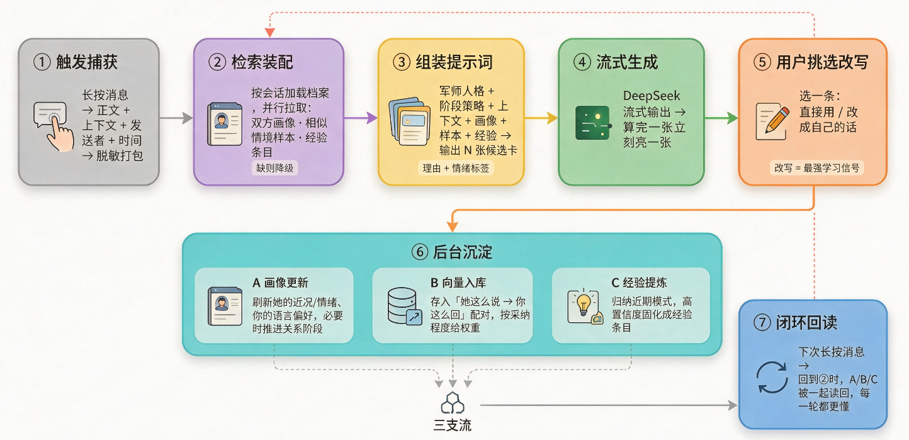

# LoveBrain

Android 悬浮窗聊天助手：把对方刚发来的那句话交给它，它帮你想下一句怎么说。

它不代聊，也不会替你发出去。一次给你最多 8 条候选，你挑一条最像自己说话方式的，改改语气再发。

## 它能做什么

- **一次八条候选**：四种语气（推荐 / 清醒 / 俏皮 / 温柔）加四种方向（跟进 / 展开 / 表达 / 转向）。
  卡片可以横向滑着看，也可以纵向列着看，设置里随时换——换摆法不重新请求、不重新花钱、不清空你已经改过的内容。
- **主动发**：不知道该不该开口、第一句说什么的时候，让它先给你角度、时机、要不要先别发、需要准备什么。
- **持续意图**：写给军师一句长期目标，开着的时候每一轮生成都会参考它；关掉就不参考，已保存的那句话原样留着。
- **本地关系记忆**：五维向量、阶段追踪、经验沉淀，越用越贴合你们两个的相处方式。
  每一轮用了哪几条记忆会列出来，觉得哪条不对可以在那一条上直接修正，修正过的内容下一轮不再被引用。
- **多知识库**：一个人一本，或者一件事一本，设置里直接切；切过去之后屏幕上读的就是那一本的数据。
- **悬浮球可调**：大小三档、背景透明度，能拖着贴边；收起到球只是收起来，不等于把服务关掉。

## 三步开始

1. 安装后授予悬浮窗权限，从首页启动，屏幕上留下一颗可以拖动的球。
2. 打开面板，选一家 AI 服务商（DeepSeek 或其他 OpenAI 兼容接口），填 baseUrl、model 和 API key。
   key 用 Android Keystore 加密存在本机。
3. 在聊天应用里长按对方发来的那条消息，或者把内容粘进输入框，点「生成回复」。

无障碍权限是可选的，只用于长按时自动捕获消息内容；不开的话手动复制粘贴一样能用。
它也不会自动点击或替你发送任何消息。

## 隐私

- 没有 LoveBrain 后端：无账号、无遥测、无统计、无广告 SDK。
- 唯一的网络出口是你自己配置的那家 AI 服务商请求。
- 聊天记录上下文、知识库、画像全部是 App 私有目录里的本地文件；系统云备份已关闭（`allowBackup=false`）。
- 知识库导出是明文 zip，分享前请自己检查里面的内容。

## 下载

最新发布见 [Releases](https://github.com/bystery/LoveBrain/releases)，下载版本页里的 APK 直接安装。

需要 Android 8.0（API 26）及以上，并自备 AI 服务商的 API key。

## 从源码构建

```bash
git clone https://github.com/bystery/LoveBrain.git
cd LoveBrain
./gradlew assembleDebug
```

产物在 `app/build/outputs/apk/debug/`。Windows 上项目路径请只用 ASCII 字符，否则构建工具链会报错。

## 工作原理



## 演示


这段录屏拍于 1.3.0 那一版，主按钮那一行和整个设置页在这之后都换过，看个流程就好，别把它当现在的界面。新录屏待补。

## 性能

一次真实运行的读数（首字延迟、缓存命中率、五十道题的花费）连同它们的限定条件放在
[BENCHMARK.md](BENCHMARK.md)。那批数字目前不可原样复现，只当量级参考，别当承诺看。

## 许可

AGPL-3.0 或商业许可，见 [LICENSE](LICENSE)。闭源商用需获得维护者许可。

个人项目。欢迎提 pull request，但没有支持 SLA。
