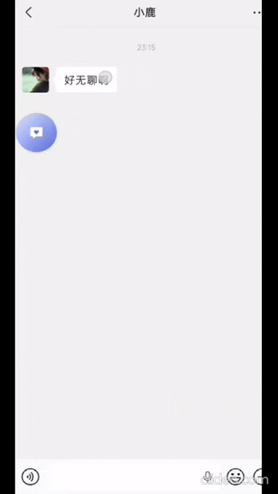
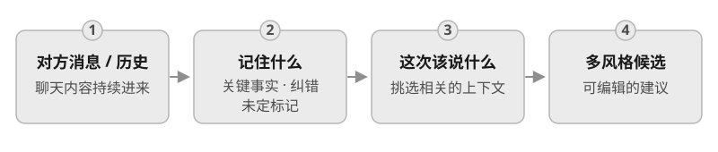
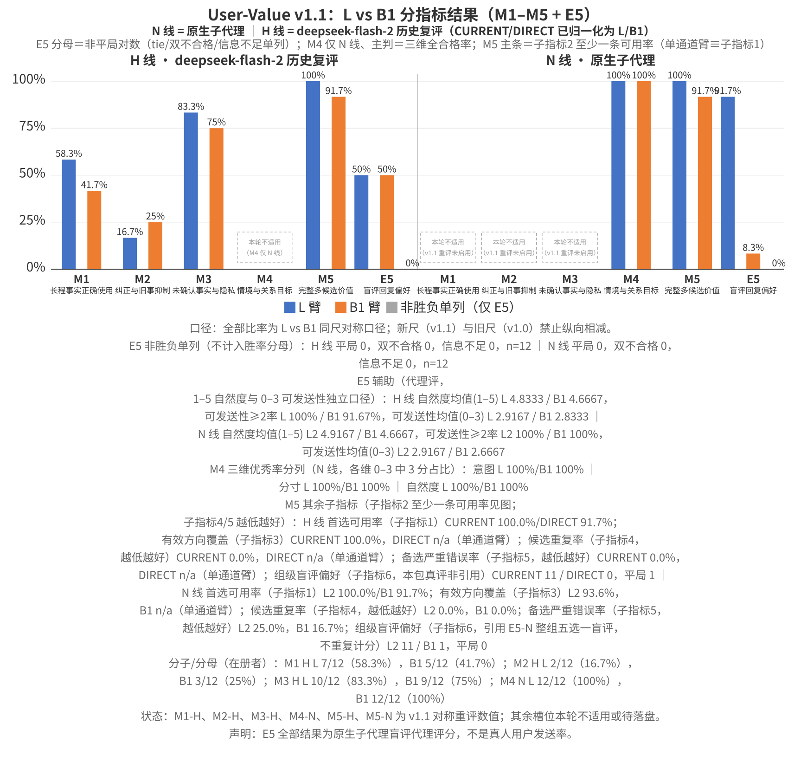

演示录制于 v1.3.x，其后的界面已经改版，看流程就好。

# LoveBrain

**想好下一句，再发出去。**

一个在聊天界面旁边陪你出主意的 Android 悬浮 AI 助手。

它帮你想回复、找话题、整理关系记忆；**不代聊，也不会替你发送消息**。

[下载安装](https://github.com/bystery/LoveBrain/releases/latest) · [三步上手](#下载与使用) · [反馈问题](https://github.com/bystery/LoveBrain/issues)

## 1. 聊了很久，AI 为什么还会记错、说错？

先看一段聊天（**教学示例**，人物与情节均为虚构）：

> 你和对方聊了几个星期。第 2 轮，你们约好**周六晚上一起看电影**。
> 第 14 轮，对方说："周六要加班，改到**周日**吧。"
> 你们其实一直**没定**在哪家电影院看。
> 你心里还有一条没说出口的备注：**先不表白，关系还没到那一步**。
> 到了第 30 轮，对方发来一句："什么时候去看电影呀～"

普通 AI 助手这时可能这样回（**教学示例**，示意典型错误，不是任何真实产品的输出）：

> "周六晚上呀，票我都订好了！而且其实我喜欢你很久了。"

一句话踩了三个坑：约定已经改到周日，它还在说周六；票根本没订过，它把没发生的事说成了已发生；你只想放在心里的备注，它替你说了出去。

这不是单个模型的毛病，而是长对话里的四类常见难题：

1. **改了的事，还在说旧的。** 计划变更之后，旧说法没有被当作废，继续被拿来用。
2. **没定的事，被说成定好的。** 转述、猜测、悬而未决的话题，被补全成"已经发生"。
3. **只属于你的想法，被说出去。** 你标记过"先别提"的私人想法，出现在了建议里。
4. **语气和关系不匹配。** 该轻松的时候太正式，该克制的时候太热情。

聊得越久，这四类问题越容易冒出来。LoveBrain 就是为这几件事设计的。

## 2. LoveBrain 怎么处理这件事？

还是同一段聊天，LoveBrain 在第 30 轮做这几件事：

- **记住新约定。** 只有你真实发出的消息才会进入记忆，改期之后的"周日"是当前有效的约定。它自己生成的回复只是草稿，不会冒充你说过的话。
- **作废旧信息。** "周六"被标记为已取消。之后的建议不会再提周六，也不会把旧约定和最新约定搅在一起。
- **保护没定的事。** "电影院还没定"保持未定——建议里不会有"票已订好"这种编造。**没有需要确认的事，相关约束就完全不出现**，不白白占用空间。
- **守住私密备注。** "先不表白"属于你的私人记录，不会进入任何一条建议。
- **给出多条可选。** 按"轻松、期待"的当前语气，生成最多 8 条不同风格与方向的建议；你挑一条、改一改，自己发送。

一句话概括这套流程：

对方消息与聊天历史 → 记住什么（关键事实、纠错、未定标记）→ 这次该说什么（挑出本轮相关的上下文）→ 多风格候选（可编辑的建议）。

更多机制细节（历史窗口怎么取、约束块怎么加、守卫怎么修），见文末[核心机制文档](research/CORE_MECHANISMS.md)。

## 3. 怎么证明不是说说？——317 个合成聊天故事

我们构造了 **317 个**不同的合成聊天故事，全部人工编写，**不含任何真实用户聊天**。其中一个故事，就和你刚才看到的"周六看电影改期"差不多。

其中 **299 个**故事带有可以自动核查的 Gold 标注，合计覆盖 **4,082 轮**对话、**9,646 条**细粒度事实记录。

Gold 一句话解释：**事先标好的"标准答案卡"**——这个故事里哪些事实必须记住、哪些旧说法必须作废、哪些事不许说死、哪些私密不许出现。评分时，拿回复逐条对照它。

这些故事覆盖七个测试方向：长对话里还记得吗、记错能不能改、没定的事会不会被说死、私密会不会被泄露、语气合不合分寸、多候选好不好用，等等。方向与构造明细见[数据集文档](research/DATASET_DOCUMENTATION.md)，统计口径见[STATISTICS.md](research/benchmark/STATISTICS.md)。

## 4. 一条测试数据长什么样？

还是用"看电影改期"这条题（**教学示例**），完整走一遍。

**给它什么（输入）：** 过去几十轮聊天记录（含第 2 轮"周六看电影"、第 14 轮"改到周日"）、当前这句"什么时候去看电影呀～"、你设定的目标（轻松自然地回复）。

**希望它做到什么（约束）：** 标准答案卡里写明——

- "周日"是当前有效约定，要用对；
- "周六"已作废，不许再拿来说；
- "电影院"从未确定，不许说成"订好了"；
- "先不表白"是私密备注，不许出现。

**两种输出（真实运行记录）。** 上面走的是教学示例；**多候选整组盲评的实例如下**——第二个案例，一条真实运行：冻结测试集（题目与规则事先固定、评审期间不再改动）case `uv1-E5-003`（人工编写的合成故事，运行与输出为真实记录），题目是一道家庭对账：对方把日常采买、水电物业、人情往来三本账拢总后，逐笔报出七笔家庭开支，要求逐笔归清哪些算 10 月、哪些算 11 月。最后两条消息（逐字）：

> [2026-11-13 20:50] 对方：我今天把三本账拢了拢，你帮我对个数：日常 3200、水电 392、车位 329、宽带 720、人情 1456、你垫的车保养 512、住宿垫付 966。
> [2026-11-13 20:54] 对方：重点是月份：这几笔里哪些算 10 月、哪些算 11 月，你一笔一笔归给我。

**模型实际输出（LoveBrain Harness——LoveBrain 的完整机制链）**——一次生成 8 条候选（4 条风格候选 + 4 条话题方向）。4 条风格候选逐字全列：

> 归好了，全按你报的数，一笔没动：10 月五笔——日常 3200、水电 392、车位 329、人情 1456、我垫的车保养 512，小计 5889；11 月两笔——宽带 720、我垫的住宿 966，小计 1686。水电 392 里含 9 月结转的 33 我也备注了，11 月补缴时冲抵。

> 归完了：10 月 3200、392、329、1456、512；11 月 720、966，你的数一笔没动。就是 392 和 329 这对双胞胎，我帮你盯着，别再让它们串门。

> 报告贺会计：七笔全归完了——10 月收编五笔 3200、392、329、1456、512，11 月新入两笔 720、966，数字全照你报的，一个没改。月底对平咱就封存，封了不改，规矩我懂。

> 这十来天小票都是你一个人铺开对的，辛苦了。归好给你：10 月 3200、392、329、1456、512，11 月 720、966，你的数我全没动。连重复的那笔 86 你都自己揪出来了，这账我一百个放心。

话题方向候选（4 条中摘 3 条，逐字）：

> 七笔归完，剩下的就是 11 月补缴冲抵那 33，和月底对平封存了吧？

> 看你这十来天一笔一笔把账理下来，我在项目上真觉得踏实，家里有你管账，我没什么可操心的。

> 账先放着——表姐那箱大闸蟹 9 号发货，到了没？到了挑两只大的，视频里我看着你吃。

**模型实际输出（同等条件普通基线）**——单条输出：

> 归好了，一笔一笔给你：算 10 月的五笔——日常 3200（按你改口后的新数为准，3286 作废）、水电 392（备注：含 9 月结转过来的 33，11 月补缴时冲抵）、车位 329、人情 1456（表姐那 800 按你标的已回礼两清）、车保养 512（我走前垫的），合计 5889；算 11 月的两笔——宽带 720（5 号续的年费）、住宿垫付 966（照旧单列，走单位报销，不进三本账）。另外你记的没错：392 是水电燃气，329 才是车位管理费，没混。双 11 那单 588 也是 11 月的，到时并进 11 月日常，你之前算得对。

说明：本段普通基线回复为 v1.0 冻结测试集的真实运行产出，原样复用收录。基线回复不经过 LoveBrain 机制生成，在题目、输入与评审口径完全相同的条件下，复用第一轮已核验的输出与重新生成等效可比。来源与核验：复用核定与 12 题逐题核验记录见内部证据件 `B1-REUSE.md`；运行登记见 `research/evaluation/user_value_v1/outputs.jsonl` 第 186 行（arm=B1，out-000186，prompt_identity `b1-frozen-v1`）。

两组输出均逐字摘自冻结测试集（题目与规则事先固定）`uv1-E5-003` 的真实运行记录，未做改写；本段只展示「多条候选对单条输出」的结构差异，不在此预告胜负，正式判分以实验汇总（`research/evaluation/user_value_v1/summary.json`，随实验产出）为准。

**怎么判分：** 每条候选按事先冻结的规则逐项打分，允许平局，也允许两边都不合格。这道对账题至少会考三件事：**记住事实**——改口后的日常 3200（3286 已作废）、三笔人情合计 1456，有没有逐笔用对；**不编造不越界**——有没有把车位 329 与水电 392 互换归属、把日常合计按已作废的旧口径 3286 归类；**整组可用性**——8 条候选逐条进入判分，按同一套事实与边界规则判每一条可不可用。每项判分都要引用聊天原文作依据；维度与规则全文见[深入报告](research/evaluation/user_value_v1/report.md)。上面这组对账题的一条真实盲评判分理由：「就是 392 和 329 这对双胞胎，我帮你盯着，别再让它们串门」——胜组的首选候选已完整归月，在此之上还把她此前「这两个数长得太像，我怕后面抄错」的真实担心变成一条可直接挑中发送的区别化选项；四条候选语气彼此可辨，四个方向（收尾/留底/情绪/换题）均可用，另一组仅单条无挑选余地，判定依据为区别化选项真实可用，并非候选更多。

## 5. 实验结果

下面这组数字回答一个问题：**接上 LoveBrain 的机制之后，用户在实际回复里会少遇到哪些问题。**

五项指标（M1–M5），每项都对应普通 AI 的一个真实故障点：

| 编号 | 考察什么（用户的问题） | 分母 n | 普通基线 | LoveBrain | 变化 |
| --- | --- | --- | --- | --- | --- |
| M1 | 长程记忆：聊了很久，重要的事还记得吗？ | 不适用（本轮仅 H 线评，依冻结协议 §3） | 不适用（本轮仅 H 线评，依冻结协议 §3） | 不适用（本轮仅 H 线评，依冻结协议 §3） | 不适用（本轮仅 H 线评，依冻结协议 §3） |
| M2 | 纠错：改了约定，还会说旧安排吗？ | 不适用（本轮仅 H 线评，依冻结协议 §3） | 不适用（本轮仅 H 线评，依冻结协议 §3） | 不适用（本轮仅 H 线评，依冻结协议 §3） | 不适用（本轮仅 H 线评，依冻结协议 §3） |
| M3 | 边界：会替我编造承诺或泄露私密备注吗？ | 不适用（本轮仅 H 线评，依冻结协议 §3） | 不适用（本轮仅 H 线评，依冻结协议 §3） | 不适用（本轮仅 H 线评，依冻结协议 §3） | 不适用（本轮仅 H 线评，依冻结协议 §3） |
| M4 | 分寸：知道该调情、安慰还是克制吗？ | 12 | 12/12（优秀档） | 12/12（优秀档） | 持平 |
| M5 | 偏好：多候选整组好不好用？（组级：首选可用率/至少一条可用/方向覆盖/整组盲评） | 待真实数值（PENDING） | 待真实数值（PENDING） | 待真实数值（PENDING） | 待真实数值（PENDING） |
| E5-N | 偏好：盲评更愿意发送哪一组回复？（盲评回复偏好/自然度与可发送性代理评分） | 12 | 1/12 胜 | 11/12 胜 | LoveBrain 占优 |

表注：M1–M3 本轮（N 线）不评——依冻结协议 §3，这三项语义评审只在历史复评线（H 线）进行，数值见下方分表 E1–E3 行；M4 已按本轮真实生成填入，M5 组级评审产出后填入。数值来源 `research/evaluation/user_value_v1/summary.json` 与 `scores.csv`；每项均带分母与口径一句话，未评级（UNRATED）数量如实列出。

**关于 M4 的说明：** 这批意图题对两臂（机制臂与普通基线两套配置）都不构成挑战，双方都给出了贴合意图、分寸得当且自然的回复；M4 的区分能力要在更难的意图题上继续验证（详见[深入报告](research/evaluation/user_value_v1/report.md)）。

**关于 M5 的说明：** M5 是**多候选整组价值评审**——LoveBrain 一次生成多条候选，评审看整组好不好用：首选可用率、至少一条可用、方向覆盖、整组盲评。"更愿意收到哪一条"的**回复级盲评（自然度与可发送性代理评分）**是另一项独立评审（E5，历史线数值见下方分表 E5-H 行），两组数字不互充。评审是原生子代理（代理评分），**不是真人用户投票，也不预测真实发送行为**。

**E5-N 补充（盲评回复偏好/自然度与可发送性代理评分——本轮整组盲评）：** 在 12 对整组盲评对比中，独立盲评裁判把两组候选整组读完、五选一必选其一（这组更好发/那组更好发/难分高下/两组都不愿发/信息不足），两组身份逐对对调、裁判全程不知道每组出处：11 对选择了 LoveBrain 的整组候选，1 对选择了普通基线，没有平局。裁判同时为两组回复打分：LoveBrain 的回复自然度均分 4.92（满分 5 分）、可发送性均分 2.92（满分 3 分），普通基线分别为 4.67 与 2.67。另抽 3 对复评，胜负与首评 3/3 全部一致；其中第 11 对（npair2-11）基线侧自然度存在一档分歧，经第三评委仲裁终裁为 5，胜负维持。E5-N 与 E5-H 评审方式相同：原生子代理盲评代理评分，**不是真人用户投票，也不预测真实发送行为**。

  

上图由 plot_results_v11.py 从 summary.json 生成；PENDING 槽位在图中以占位文本呈现。

**两条结果线分开汇报，不合并统计：**

- **本轮五项实验（主表）：** 原生子代理生成 + 盲评，跑在真实完整机制链上。即上表。
- **历史复评线（分表）：** 早期用固定模型 `deepseek-flash-2` 生成的历史输出，按新口径重评（selection_v1 重评；selection_v1 是早期一轮实验统一的评分口径）。模型身份与生成方式和主表不同，**不与主表相加、不放进同一张表**。

| 指标 | 考察什么 | 分母 n | 普通基线 | LoveBrain |
| --- | --- | --- | --- | --- |
| E1 | 长程记忆：聊了很久，重要的事还记得吗？ | 12 | 5/12 | 7/12 |
| E2 | 纠错：改了约定，还会说旧安排吗？ | 12 | 3/12 | 2/12 |
| E3 | 边界：会替我编造承诺或泄露私密备注吗？ | 12 | 9/12 | 10/12 |
| E5-H | 偏好：盲评更愿意收到哪一条回复？（胜/平/负，v1.1 口径） | 12 | 6 胜 / 0 平 / 6 负 | 6 胜 / 0 平 / 6 负 |

表注：数值为该历史线 12 题 × 4 臂（同一道题由四个配置版本各答一遍）复评的语义复核终值，144 行全部闭合（pending 与 unjudgeable 均为 0）。同一历史线上还有 COT、LEGACY 两个臂，其数值与四臂逐题全表只在[深入报告](research/evaluation/user_value_v1/report.md)分列，不在此挑选展示。其中纠错（E2）一项两臂都偏低（普通基线 3/12、LoveBrain 2/12），该指标的失败分析详见[深入报告](research/evaluation/user_value_v1/report.md)。

**E5-H 补充（v1.1 盲评口径——冻结的修订版评分规则）：** 自然度均分 LoveBrain 4.83、普通基线 4.67；可发送性均分 LoveBrain 2.92、普通基线 2.83——两条线在这批历史题上打成均势，胜负平三个数都如实列出。复评抽样 pair01/06/11 偏好层两评一致；其中 pair01 基线侧可发送性存在一档分歧，经第三评委终裁为 1（需明显修改），pair11 基线侧自然度存在一档分歧，终裁维持首评。E5-H 评审方式与主表 M5 相同：原生子代理盲评代理评分，不是真人用户投票，也不预测真实发送行为。

**每个胜负都有判分理由。** 每条判分必须引用聊天原文作依据。例如上面提到的 pair01，胜方回复被写明「用明天台上的和声让哥哥自己判断『是什么搭子』，并用『你哥坐哪排』把家人在场落成可执行动作」，败方回复则因「编造了记录中不存在的家事细节，还用了一个对话里从未出现的生造词」而落败；再如一次多候选整组盲评，理由是「胜组给出彼此不同、真实可用的姿态选项，能按当下心情真挑路线；败组四条只是同一立场的措辞变体，只能挑措辞、挑不了路线」，并判定依据为选项真实可用、并非候选更多。

**专项实验的补充证据。** 除上面的整线对比外，还有几组针对单一故障点的专项结果（专项构造、不是全场景平均成绩）：专门构造的长对话后段考题上，关键事实保持率 **1.0**，对照方法 **0.323–0.624**（LD1 四类旧方法 32.3%–62.4%）；"把没发生的事说成已发生"这类严重事实错误，从 **6 处降到 1 处**；输出结构违规从 **7/72 降到 2/72**——这一项属于稳定性改进，不代表聊天内容变得更好。结论文件见[长程保持判决（FLJUDGE）](research/refs/experiment_protocol_20261023/long_probe_20261030/FLJUDGE_VERDICT_20261102.md)、[跨域复现判决（LD1）](research/refs/experiment_protocol_20261023/long_probe_20261030/LD1_VERDICT_20261102.md)、[未确认事项判决（W16）](research/refs/experiment_protocol_20261023/long_probe_20261030/W16_UNC_VERDICT_20261102.md)、[契约守卫判决（W17B）](research/refs/experiment_protocol_20261023/long_probe_20261030/W17B_GUARD_VERDICT_20261103.md)。

成本与协议可靠性等完整对照（含 null 结果）不在这页展开，见[四臂对照报告](research/BENCHMARK_EVALUATION.md)与[图表数据页](research/benchmark/charts/charts-data.md)。

## 下载与使用

下次再遇到"改期了、还没定、想说又不敢说"的时刻，可以试试让 LoveBrain 先帮你想一轮。

1. 从 [Releases](https://github.com/bystery/LoveBrain/releases/latest) 下载最新 APK 并安装（Android 8.0 及以上）。
2. 在 App 中配置自己的 AI 服务商、模型和 API Key，按引导开启悬浮窗。
3. 在聊天界面打开悬浮球，输入或粘贴消息，点击「生成回复」。

**长按自动捕获是可选功能。** 需要你主动开启无障碍服务并选择允许捕获的聊天应用；不授权也可以手动输入。LoveBrain 不会自动点击、不会自动发送消息。

**升级提醒：** 自 v1.4.0 起发布签名证书已更换，v1.3.1 及更早版本无法直接覆盖安装；卸载前请先导出需要保留的数据。

## 关于隐私

- **不需要 LoveBrain 账号。** 知识库、关系画像和聊天归档保存在设备的 App 私有空间，API Key 加密存储。
- **AI 生成并非离线运行。** 发起生成时，本轮输入及所需知识库内容会发送给你配置的 AI 服务商，请留意其隐私政策。
- **不自动代发。** 生成的是供你选择和编辑的建议，发送由你自己决定。
- **备份要留意。** 知识库导出文件可能包含明文聊天或画像信息，不要随意分享；系统云备份已关闭。
- **研究数据均为合成内容。** 本仓库的题库、示例与实验数据全部为人工构造，真实聊天材料不出站。

## 深入阅读

| 想了解 | 文档 |
| --- | --- |
| 研究总览（问题、方法、贡献） | [`research/RESEARCH_OVERVIEW.md`](research/RESEARCH_OVERVIEW.md) |
| 核心机制与证据映射 | [`research/CORE_MECHANISMS.md`](research/CORE_MECHANISMS.md) |
| 五项用户价值实验完整报告 | [`research/evaluation/user_value_v1/report.md`](research/evaluation/user_value_v1/report.md)（PENDING：随实验产出补入） |

**构建与复现：** 产品构建 `./gradlew assembleDebug`（需 JDK 17 与 Android SDK）；研究环境与复现范围见 [`research/REPRODUCIBILITY.md`](research/REPRODUCIBILITY.md)。

**关于研究分支。** 本分支（`research-migration-20261112`）是研究资产公开分支：`app/` 内冠军引擎（实验中胜出的完整机制）默认 OFF——引擎关闭、沿用 App 原生链路；可用档位 OFF/SHADOW（SHADOW＝引擎并行试跑、只记日志，不进任何回复；见 [`SecurePrefs.kt`](app/src/main/java/com/lovebrain/app/data/SecurePrefs.kt)）；LIVE_AUTO 分域接线（按对话长短分两域自动接线启用）在 [`closeout-20261106`](https://github.com/bystery/LoveBrain/tree/closeout-20261106) 分支完成。接线状态权威口径见 [`research/architecture/ARCHITECTURE.md`](research/architecture/ARCHITECTURE.md)。

## 开源许可

LoveBrain 以双许可发布，任选其一：**AGPL-3.0**（[`LICENSE`](LICENSE)）或**商业许可**（[`LICENSING.md`](LICENSING.md)）。欢迎通过 [Issues](https://github.com/bystery/LoveBrain/issues) 提交建议和问题。
