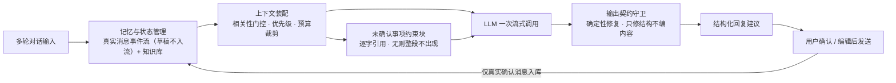
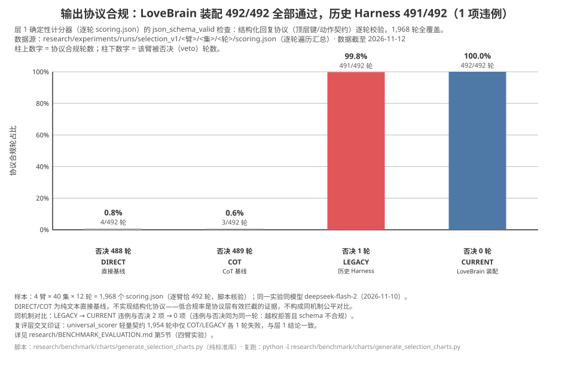
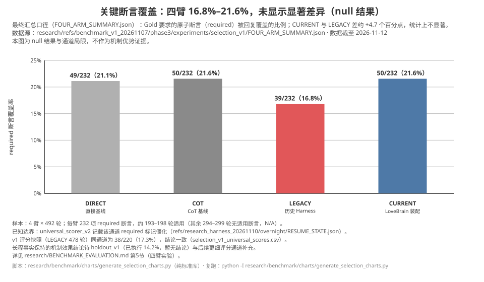

# LoveBrain

**面向长程对话的记忆与上下文管理研究，以及一台真的在用的 Android 聊天辅助产品。**

LoveBrain 不只是"给聊天建议"的工具。Prompt 只是输入的一部分——这个项目真正研究的，是记忆如何形成、信息何时注入、旧事实何时失效、未确定的事如何保持未确定，以及模型输出如何被确定性处理。我们把候选机制放进独立实验环境做对照与消融，只有获得判决支持的机制才移植进 Android 产品。

---

## 1. 这是一个什么项目

| | |
| --- | --- |
| **研究主线** | 长程对话中的记忆与上下文管理：机制设计、对照实验、判决驱动 |
| **产品落地** | Android 悬浮窗聊天助手（Kotlin/Compose），验证过的机制接入正常生成链路 |
| **数据集** | 317 个去重合成故事；299 个 Gold 覆盖 episode / 4,082 轮 / 9,646 条原子断言（逐字回验全通过） |
| **实验证据** | 53 份判决文件全量公开，含负结果与未判定结果 |
| **研究资产** | 全部落在本仓 [`research/`](research/)：题库、Gold、候选机制、实验记录、判决书、复现工具 |

## 2. 研究问题：长对话里，AI 为什么会"记错"

聊天辅助场景中，模型面对的不是一轮问答，而是几十轮的连续关系。我们从真实使用中提炼出四类失败模式，全部机制都从这些问题出发：

1. **早期事实滑出窗口。** 长对话中丢失的不是大概主题，而是具体事实：早期的金额、日期、约定、决定主体、重要原话。滑动窗口把早期消息移出上下文之后，模型只能"漏"或"编"。
2. **旧信息、无关记忆干扰当前轮。** 记忆不是越多越好：全量注入会让已结束的话题重现、用户已经改变想法的旧目标继续生效、旧事项挤占上下文预算。**存储里存在，不代表当前轮应该使用。**
3. **用户纠正没有被正确更新。** 事实被更正或取消之后，旧说法仍可能被当作有效事实重复使用。
4. **未确定的事情被当成事实。** 转述、推测、悬而未决的问题，被模型补全成"已发生"。

## 3. 核心技术方案

三条机制主线，每条按「问题 → 方法 → 效果 → 证据」说明。全部对比在同一模型服务、同一题集、同一评分器下进行。

### 3.1 上下文装配与相关性门控

- **问题：** 上面第 2 类——记忆很多，但本轮不一定相关。
- **方法：** 先判断哪些状态仍然有效、哪些信息与当前轮相关，再按优先级组织上下文并控制预算：持续事项四态生命周期（进行中/休眠/已结束/已取消）+ 冷却、话题切换门、纠正事实过滤（被纠正的旧事实不再进入上下文）、场景与意图装配、超预算三步裁剪。
- **效果：** 整合候选 `rh_converge` 获判决 KEEP（效率型）：Token/轮 1,090 vs 1,420（约 −23%），五维质量均值与直接注入基线基本持平（4.67 vs 4.69，−0.3%；对照值来自更大样本池审计口径）。代价：端到端 P50 42 秒 vs 约 20 秒——更多上下文处理不自动等于更快。
- **证据：** [`research/refs/research_harness_20261110/overnight/`](research/refs/research_harness_20261110/overnight/) 台账；机制详解见 [`research/CORE_MECHANISMS.md`](research/CORE_MECHANISMS.md) §2。

### 3.2 证据优先的长程记忆管理

- **问题：** 上面第 1 类——早期具体事实已不在当前可见上下文里。
- **方法：** 三个部件。① **真实消息事件流**：只有用户确认发出的真实消息入库，模型生成的回复只是草稿不进入历史——"模型说过一句话，不代表用户真的发送过这句话"；② **3600 CU 完整消息历史窗口**：按 UTF-16 code unit 计量、从最新向前保留完整消息、不切半句；③ 消融实验证明摘要段可无损删除后，不再装配 recap。
- **效果：** 在第 25–32 轮（滑动窗口早已放不下的后段轮次），事实保持率 **1.0**，滑窗父本臂两篇读数 0.493 / 0.509；跨四个新领域（出行拼车/工作职场/餐饮聚会/医疗健康）复现，四篇保持率全部 1.0 vs 父本臂 0.323–0.624，且 Prompt 体积同时下降 41.9% / 44.0%。
- **证据：** [`FLJUDGE` 判决](research/refs/experiment_protocol_20261023/long_probe_20261030/FLJUDGE_VERDICT_20261102.md)、[`LD1` 判决](research/refs/experiment_protocol_20261023/long_probe_20261030/LD1_VERDICT_20261102.md)（[`W15N01` 消融](research/refs/experiment_protocol_20261023/long_probe_20261030/W15N01_ABLATION_VERDICT_20261102.md)：删除 recap 后两臂保持率 1.000/1.000，Prompt −0.3%——结论是"无损可删"，不是"摘要有害"）。

### 3.3 事实约束与输出可靠性管理

- **问题：** 上面第 3、4 类——未确认的事被说成已发生；输出结构漂移。
- **方法：** 输入侧"未确认事项约束"：检测转述/推测/引号转述三类信号，命中才注入短约束块（最多 3 条、原始逐字引用不改写、整段 ≤120 CU；**没有未确认事项时整段完全不出现**）；输出侧"确定性契约守卫"：对模型返回做去围栏、键名映射、缺槽补 null 等确定性修复——**只修结构，不替模型编造内容**。
- **效果：** severe 级事实错误亲读账 6 → 1（Prompt 开销仅 +0.78%，零额外模型调用，且只在 29.2% 的轮次触发——机制只在有需要时增加上下文）；输出契约违规 7/72 → 2/72（Prompt +0%，零额外调用）。
- **证据：** [`W16` 判决](research/refs/experiment_protocol_20261023/long_probe_20261030/W16_UNC_VERDICT_20261102.md)、[`W17B` 判决](research/refs/experiment_protocol_20261023/long_probe_20261030/W17B_GUARD_VERDICT_20261103.md)、[短域复评 `W17C`](research/refs/experiment_protocol_20261023/long_probe_20261030/W17C_MERGE_VERDICT_20261103.md)。

### Harness 全景



### 实现状态

三条机制都走同一流程：Arena 研究原型（Python，[`research/candidates/`](research/candidates/)）→ 判决（KEEP/MERGE/淘汰）→ Kotlin 移植（`app/src/main/java/com/lovebrain/app/domain/champion/`）→ 生产接线。

生产接线状态按分支区分：**LIVE_AUTO 分域接线**（≤24 轮执行契约守卫、≥25 轮注入未确认事项约束，两域都注入 3600 CU 历史块）在 [`closeout-20261106`](https://github.com/bystery/LoveBrain/tree/closeout-20261106) 分支完成并通过 CI；**本分支（`research-migration-20261112`，研究资产公开分支）的 `app/` 代码不含该接线：冠军引擎默认 OFF，可用档位仅 OFF/SHADOW**（见 [`app/src/main/java/com/lovebrain/app/data/SecurePrefs.kt`](app/src/main/java/com/lovebrain/app/data/SecurePrefs.kt)；接线状态权威口径见 [`research/architecture/ARCHITECTURE.md`](research/architecture/ARCHITECTURE.md) 卷首分支状态声明）。整合候选 `rh_converge` 是研究线结论，未移植进产品。

## 4. 数据集

题库为**人工构造的合成多轮对话场景**（全部题面标记 `real_user_material=false`，不含真实用户材料），按 17 个层组逐层构造（构造明细见数据集文档），每个故事 = `episode.json`（题面）+ `reference.json`（参考事实卡）。

| 指标 | 数值 | 口径 |
| --- | ---: | --- |
| 去重合成故事 | **317** | 按 episode ID 去重（319 个目录 − 2 个版本副本） |
| Gold 覆盖 episode | **299** | 覆盖的是既有故事；其余 18 个为锚点/收口探针（设计如此） |
| Gold 题目轮 | **4,082** | 一次题目轮为一轮 |
| Gold 原子断言 | **9,646** | 每条带与题面逐字一致的原文引用，逐字回验 9,646/9,646 通过 |

统计口径详见 [`research/benchmark/STATISTICS.md`](research/benchmark/STATISTICS.md)（唯一口径页）。

**覆盖什么问题：** 七个测试方向——长程事实保持 / 记忆提取写入 / 记忆更新纠错 / 检索相关性 / 未知不确定性 / 进行中事项追踪 / 上下文预算与输出契约（D1–D7）。各方向样本可重叠、七数不相加，唯一池 = 299。方向与缺口明细见 [`research/DATASET_DOCUMENTATION.md`](research/DATASET_DOCUMENTATION.md)。

**Gold 如何标注：** 评分卡与参考事实卡两层证据源合并生成 Gold 侧车（14 个分文件）；每条断言带主体/关系/取值/有效期/状态，其中"取消族"状态构成 must-not-affirm 方向——回复坐实已被更正的旧说法即失分。评分由带 C0–C15 检查点的确定性评分器 + 经人评校准（与人工评审一致率 ≥80%）的 Judge 评审执行，规则见 [`research/benchmark/rubric.md`](research/benchmark/rubric.md)。

**一个例子（合成示意，非真实实验样本，人物与内容均虚构）：**

> - **第 2 轮（用户）**："周六上午陪我妈去市图书馆复习概率论，她考试就是这周六。"
>   → 应记住：科目＝概率论、地点＝市图书馆、考试时间＝本周六。
> - **第 9 轮（用户）**："考试改到下周三了，周六不用去了。"
>   → 应更新：考试时间改为下周三，旧时间"本周六"作废——之后的回复不得再说"周六考试"。
> - **第 26 轮（用户）**："那天到底要不要提前预约座位来着？"
>   → 未确定："是否需要预约"从未确认——回复不得把它当事实回答。
> - **第 30 轮**：第 2 轮的科目与第 9 轮的改期仍在考核范围内——滑动窗口早已放不下的内容，正是长程保持率考核的对象。

## 5. 实验结果

§3 的效果数字（保持率 1.0 vs 0.49–0.62、Prompt −41.9%/−44.0%、severe 6→1、契约违规 7/72→2/72）是**判决级对照**，来自长剧探针与分域判决文件（证据链接见 §3）；本节是**同批四臂系统对比**：4 臂 × 40 集、同模型 deepseek-flash-2、同采样、同一评分栈，每臂 492 轮（2026-11-10 批次），全部数字由脚本程序化解析自仓内数据。两套口径不相加、不互改。臂定义与四臂实验设计详见 [`research/BENCHMARK_EVALUATION.md`](research/BENCHMARK_EVALUATION.md) 第 5 节。

<p>
  
</p>

**图 1 · 上下文使用成本：LoveBrain 装配单轮 token 为历史 Harness 的 60%。** 同批四臂实验中，CURRENT（LoveBrain 装配）单轮 4,137 tokens（prompt 2,522 + completion 1,615），LEGACY（历史 Harness）6,852 tokens，CURRENT 为其 60.4%；平均延迟 120.4 秒 vs 135.2 秒（89.0%）。脚注：4 臂 × 40 集、每臂 492 轮（LEGACY 评分快照 478 轮；最终 492 轮总量见 FOUR_ARM_SUMMARY.json，单轮均值差 <1%）；同模型、同采样、同一评分栈。解读边界：DIRECT（1,479）/COT（1,574）token 更低，但作为纯文本基线不实现结构化输出协议（见图 2），非同机制公平对比；本图的同机制对比对象是 LEGACY → CURRENT。数据与口径详见 [`research/benchmark/charts/charts-data.md`](research/benchmark/charts/charts-data.md) 图 D。

<p>
  
</p>

**图 2 · 输出协议合规：CURRENT 492/492 全部通过，LEGACY 491/492（1 项违例）。** 层 1 确定性计分器逐轮校验结构化回复协议（json_schema_valid），1,968 个逐轮 scoring.json 全覆盖：DIRECT 4/492（0.8%）、COT 3/492（0.6%）、LEGACY 491/492（99.8%，1 轮否决）、CURRENT 492/492（100%，0 否决）。脚注：4 臂 × 40 集 × 12 轮、逐臂恰 492 轮（脚本核验）；同模型、同采样、同一评分栈。DIRECT/COT 为纯文本基线、不实现协议，低合规率是协议层有效拦截的证据，非同机制对比；同机制对比 LEGACY → CURRENT 违例与否决 2 项 → 0 项，且该通道在两个完整 Harness 间已接近饱和、改善幅度小。数据与口径详见 [`research/benchmark/charts/charts-data.md`](research/benchmark/charts/charts-data.md) 图 E。

<p>
  
</p>

**图 3 · 关键断言覆盖：四臂未显示显著差异（null 结果）。** 长程事实保持方向在同批四臂实验中为 null 结果：Gold required 原子断言覆盖率 DIRECT 21.1%（49/232）、COT 21.6%（50/232）、LEGACY 16.8%（39/232）、CURRENT 21.6%（50/232），CURRENT 与 LEGACY 差约 +4.7 个百分点，统计上不显著——本图呈现 null 结果与通道局限，**不作为机制优势证据**。脚注：4 臂 × 40 集、每臂 492 轮；每臂仅 232 项 required 断言、约 193–198 轮适用（其余轮无适用断言、N/A）；同模型、同采样、同一评分栈。已知缺口：universal_scorer_v2 记载该通道 required 标记僵化；§3.2 的判决级保持率结论（1.0 vs 0.49–0.62）来自长剧探针判决，其系统级复现待 holdout 轨（当前仅 14.2% 部分执行、暂无判决）与更细评分通道补充。数据与口径详见 [`research/benchmark/charts/charts-data.md`](research/benchmark/charts/charts-data.md) 图 F。

**负结果与未判定结果：** 合并候选在长域出现空回复未晋升（W19）、归因变体为降低归因错误引入更严重的契约回归而 KEEP_NO_PROMOTE（W22 REV2）、反事实跟随对照落在不确定带未判定（CF1）。全部见 [`research/refs/KNOWN_FAILURES.md`](research/refs/KNOWN_FAILURES.md) 与 [53 份判决索引](research/refs/VERDICT-INDEX.md)。实验设置与消融细节见 [`research/CORE_MECHANISMS.md`](research/CORE_MECHANISMS.md)。

## 6. Android 产品落地

LoveBrain 是一个悬浮在聊天界面旁边的 AI 助手：**帮你想回复、找话题、整理关系记忆；不代聊、不替你发送消息**。

<div align="center">

<br/>
<sub>演示录制于 v1.3.x 早期版本，其后界面已改版，仅示意交互流程。</sub>
</div>

- **悬浮窗聊天辅助：** 长按捕获或手动输入，给出最多 8 条不同风格与方向的建议；挑一条、改一改，由你自己发送。
- **多轮对话输入与生成：** 支持持续多轮输入、主动开口建议（话题/开场/时机）与"仅看本轮"模式。
- **个性化知识与记忆：** 本地知识库记录相处阶段、画像与经验；本轮参考了什么可见，可纠正或暂停引用。
- **实验机制接入正常生成链路：** 获判决支持的机制（3600 CU 完整历史块、未确认事项约束、输出契约守卫）按分域策略（≤24 轮守卫 / ≥25 轮约束）接入正常生成链路，机制关闭时回复链路完整回退。

产品状态：LIVE_AUTO 分域接线在 [`closeout-20261106`](https://github.com/bystery/LoveBrain/tree/closeout-20261106) 分支已启用、本分支默认 OFF（详见 §3「实现状态」）。可下载的最新发布版本以 [Releases 页面](https://github.com/bystery/LoveBrain/releases/latest) 为准（Android 8.0+；v1.4.0 起更换签名证书，v1.3.1 及更早无法覆盖安装，升级前请先导出数据）。

## 7. 运行与复现

```bash
# 产品构建（JDK 17 + Android SDK）
git clone https://github.com/bystery/LoveBrain.git
cd LoveBrain && ./gradlew assembleDebug

# 研究环境（Python 3.12；arena/ 纯标准库零第三方依赖，tools/ 仅需 Pillow）
python -m pip install pillow
```

研究侧当前实测边界：离线 smoke test **9 PASS / 0 FAIL / 1 停用**（模块导入与文件解析级，不含端到端命令重跑）；历史 live 实验的原始答卷与判决全部保留、可重放重评分，但依赖历史模型服务、不能重新生成。环境搭建、入口点、复现范围逐项说明见 [`research/REPRODUCIBILITY.md`](research/REPRODUCIBILITY.md)。

## 8. 深入阅读

| 想了解 | 文档 |
| --- | --- |
| 研究总览（问题、方法、贡献） | [`research/RESEARCH_OVERVIEW.md`](research/RESEARCH_OVERVIEW.md) |
| 数据集构造、规模与标注 | [`research/DATASET_DOCUMENTATION.md`](research/DATASET_DOCUMENTATION.md)（统计口径：[`benchmark/STATISTICS.md`](research/benchmark/STATISTICS.md)） |
| 核心机制与判决映射 | [`research/CORE_MECHANISMS.md`](research/CORE_MECHANISMS.md) |
| 实验判决与失败档案 | [`research/refs/VERDICT-INDEX.md`](research/refs/VERDICT-INDEX.md) · [`research/refs/KNOWN_FAILURES.md`](research/refs/KNOWN_FAILURES.md) |
| 系统架构 | [`research/architecture/ARCHITECTURE.md`](research/architecture/ARCHITECTURE.md) |
| 复现 | [`research/REPRODUCIBILITY.md`](research/REPRODUCIBILITY.md) |

## 关于隐私

- **不需要 LoveBrain 账号。** 知识库、画像和聊天归档保存在设备 App 私有空间，API Key 加密存储。
- **AI 生成并非离线运行。** 发起生成时，本轮输入及所需知识库内容会发送给你配置的 AI 服务商，请留意其隐私政策。
- **不自动代发。** 生成的是供你选择和编辑的建议，发送由你自己决定。
- **研究数据均为人工构造或合成内容。** 真实聊天导出的知识库快照原件永不出站，公开面只有结构摘要与合成样本。

## 开源许可

LoveBrain 以双许可发布，任选其一：**AGPL-3.0**（[`LICENSE`](LICENSE)）或**商业许可**（[`LICENSING.md`](LICENSING.md)）。欢迎通过 [Issues](https://github.com/bystery/LoveBrain/issues) 提交建议和问题。
