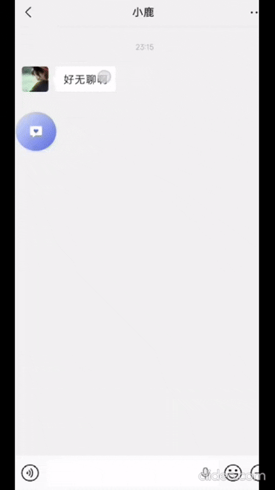

<div align="center">



<sub>演示录制于 v1.3.x，其后的界面已经改版，看流程就好。</sub>

# LoveBrain

**想好下一句，再发出去。**

一个在聊天界面旁边陪你出主意的 Android 悬浮 AI 助手。

它帮你想回复、找话题、整理关系记忆；**不代聊，也不会替你发送消息**。

[下载安装](https://github.com/bystery/LoveBrain/releases) · [反馈问题](https://github.com/bystery/LoveBrain/issues)

</div>

## 聊天时，少一点纠结

对方发来一句不知道怎么回的话？长按捕获，或者自己复制进输入框，LoveBrain 会给出**最多 8 条不同风格和方向的建议**。你可以挑一条、改一改，再亲自发送。

它也可以在你不知道如何开口时，帮你想**主动发消息的切入点**，并提醒你合适的时机，以及什么时候最好先别发。

## 你可以这样用

| 想做什么 | LoveBrain 能帮你什么 |
| --- | --- |
| **想回复** | 给出多种语气和方向；支持复制、评价和进一步调整 |
| **想主动开口** | 建议话题、开场方式、时机与注意事项 |
| **想让建议更懂你** | 建立本地知识库，记录相处阶段、画像和经验 |
| **有一个持续目标** | 写下你希望推进的方向，开启时供后续普通生成参考，关闭后不再使用 |
| **记忆有误** | 查看本轮参考了什么，并对相关记忆进行纠正或暂停引用 |
| **不想挡住聊天** | 调整悬浮球大小和透明度；回复卡片可选横排或竖排 |

## 三步开始

1. 从 [Releases](https://github.com/bystery/LoveBrain/releases) 下载 APK 并安装（Android 8.0 及以上）。
2. 在 App 中配置自己的 AI 服务商、模型和 API Key，按引导开启悬浮窗。
3. 在聊天界面打开悬浮球，输入或粘贴消息，点击「生成回复」。

**长按自动捕获是可选功能。** 需要你主动开启无障碍服务并选择允许捕获的聊天应用。不授权也可以手动输入；LoveBrain 不会自动点击、自动发送消息。

支持 DeepSeek 及部分 OpenAI 兼容接口。不同服务商的可用性和费用由对应服务商决定。

## 关于隐私

- **不需要 LoveBrain 账号。** 知识库、关系画像和聊天归档主要保存在设备的 App 私有空间，API Key 使用 Android 加密存储。
- **AI 生成并非离线运行。** 发起生成时，本轮输入及完成回答所需的相关知识库内容会发送给你配置的 AI 服务商；请留意该服务商的隐私政策。
- **不自动代发。** 生成的是供你选择和编辑的建议，发送给聊天对象由你自己决定。
- **备份要留意。** 知识库导出文件可能包含明文聊天或画像信息，不要随意分享；系统云备份已关闭。

## 版本与升级

最新可下载版本以 [Releases 页面](https://github.com/bystery/LoveBrain/releases) 为准。

**重要：** 自 v1.4.0 起，发布签名证书已更换。v1.3.1 及更早旧证书版本无法直接覆盖安装新版；卸载旧 App 会删除其本地数据，操作前请先导出并妥善保存需要的内容。v1.4.0 与后续使用相同签名的正式版本可正常覆盖升级。

## 构建

从源码构建：

```bash
git clone https://github.com/bystery/LoveBrain.git
cd LoveBrain
./gradlew assembleDebug
```

需要 Android SDK 与 JDK 17。编译产物位于 `app/build/outputs/apk/debug/`。

## 开源许可

[AGPL-3.0](LICENSE)；商业授权可联系项目维护者。欢迎通过 [Issues](https://github.com/bystery/LoveBrain/issues) 提交建议和问题。
