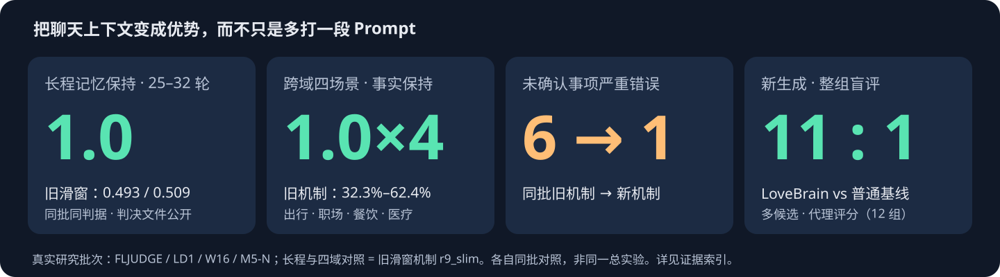
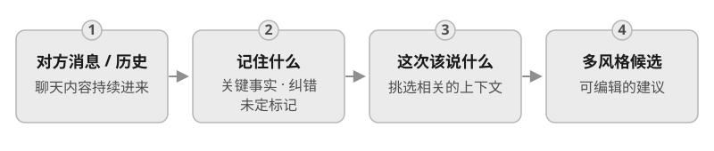

# LoveBrain

### 记住关系里的重要细节，守住事实边界，一次给你多种真正可选的回复。

**LoveBrain 是一款 Android 悬浮 AI 聊天助手。** 它在聊天界面旁工作，理解上下文、维护关系记忆、避免把猜测说成事实，并一次给出不同语气与话题方向的建议。你负责挑选、修改和发送；LoveBrain 不替你代聊。

[**下载 Android APK**](https://github.com/bystery/LoveBrain/releases/latest) · [**看一个真实跑过的测试故事**](#一个故事看懂-lovebrain) · [**查看实验与机制**](research/PAPER.md)

## 先看成绩

| 用户真正关心的事 | 已完成实验结果 | 对照对象 |
|---|---:|---|
| 聊到第 25–32 轮，还记得关键事实吗？ | **100%** vs **49.3% / 50.9%** | 旧滑动窗口 Harness |
| 换到四个新生活领域，还能保持记忆吗？ | **四个领域全部 100%**；对照为 **32.3%–62.4%** | 旧 Harness |
| 会不会把未确认的事说成已经发生？ | 严重无据坐实 **6 处 → 1 处** | 改进前父本 Harness |
| 回复结构能否稳定交付？ | 契约违规 **7/72 → 2/72** | 输出守卫加入前的父本 |
| 用户拿到完整候选组，哪一组更值得选？ | **11 胜、0 负、1 平** | 历史输出 vs Direct |
| 新生成的完整候选组表现如何？ | **11 胜、1 负、0 平** | 新生成 LoveBrain vs B1 普通文本基线 |
| 多候选不是凑数量：真正可用的选择有多少？ | **90/95** vs **27/30**；可用选项总数约 **3.33 倍** | 新生成 12 组完整候选 |
| 历史候选组的逐条可用情况如何？ | **88/89** vs **11/12**；可用选项总数 **8 倍** | 历史 LoveBrain 候选组 vs Direct |
| 第一条建议本身能不能用？ | **12/12** vs **11/12** | 历史与新生成两批均复核 |
| 回复是否守住事实边界？ | **10/12** vs Direct **9/12** vs CoT **7/12** | 12 个边界测试案例 |

以上是不同专项的真实结果，每项均保留自己的测试题、判分口径和对照对象；不把不同实验拼成一个虚构总分。

## 一个故事看懂 LoveBrain

这是测试集 E340「合唱团低音搭子」：**合成的人物与聊天故事，真实跑过模型、真实保存输出并完成盲评**。

霍青崖唱男低音，顾星晚唱女低音。两人在合唱团认识一年，互相熟悉、习惯互怼，却没有明确关系。过去的聊天已经说清：**她负责给和声手势，他跟着她的手势打拍**。她也曾撤回过夜宵邀约；撤回的事情不能被当成已经约定。

演出前一天，顾星晚发来：

> 明天演出。我哥高铁到了，我跟他说我有个特别稳的低音搭子，台上从来不抢拍。他问搭子是什么搭子，我没理他。

这句话难在三个地方：要接住她把你介绍给哥哥的暧昧信号；不能替她宣布关系；还要记得此前谁给谁打手势，不能把两人的配合说反。

### 普通 Direct 的实际输出

> 明天你只管唱，手势我给你打准，一个拍都不会让你等。你哥三年没回来，这回让他听听定音针什么水平。散场先别急着跟车走。

它把此前已经明确的配合方向说反了：实际是她给手势、他跟拍；同时把私人备注里的家庭细节直接带进了对外回复。

### LoveBrain 的实际输出

**推荐：**

> 没理他就对了，留着明天台上给他答案。你哥坐哪排？我那句和声下去，让他自己判断是什么搭子。

**俏皮：**

> 特别稳的低音搭子，这称呼我收下了，比听你喊我全名顺耳。你哥要是追问，就说这搭子管琴房钥匙。

**温柔：**

> 你哥来了，明天你唱的时候心里能踏实点。我就在你侧后方，手势一落我就跟。

**还可以换个话题方向：**「你哥待几天？」或「散场那顿夜宵，你哥要是在，我就当着他的面问清楚是什么搭子。」

这一题里，LoveBrain 交付了 **7 条非空候选**，包括风格回复和话题方向；Direct 交付 1 条。LoveBrain 的 7 条均通过该题的可用性判定，Direct 的单条没有通过。

更重要的是，这不是只挑这一题讲故事：在 12 组历史完整候选盲评中，LoveBrain **11 胜、0 负、1 平**。如果只看第一条推荐，历史批次其实是 **6:6**；看用户真正拿到的完整候选组，差距才显现出来。这正是多候选机制应该被评估的方式。

[查看完整故事与时间线](research/benchmark/stories_v2/wave5_selection/E340/episode.json) · [LoveBrain 原始输出](research/experiments/runs/selection_v1/CURRENT/E340/turn_10_E340_T10/reply_raw.txt) · [Direct 原始输出](research/experiments/runs/selection_v1/DIRECT/E340/turn_10_E340_T10/reply_raw.txt) · [该题逐项盲评](research/evaluation/user_value_v1/m5-eval/hpair2-01.json)

## 多候选为什么是机制优势

我们没有为了“看起来公平”而把 LoveBrain 的候选数量削成和 Direct 一样。**双方按各自真实机制生成，评估真实交付给用户的完整候选组。** 评分规则也明确规定：候选数不相等不扣分；单纯因为数量更多而偏好某组，必须判平局。完整候选组由原生子代理进行匿名评审。真正决定胜负的是：候选是否可用、彼此是否有区别、是否有严重错误污染，以及整组是否更容易让用户找到想发的那一句。

| 完整候选组 | LoveBrain | 基线 | 结果 |
|---|---:|---:|---|
| 新生成 12 组 | 95 条候选，其中 **90 条可用** | 30 条候选，其中 **27 条可用** | LoveBrain 可用选择约 **3.33 倍**；整组盲评 **11:1** |
| 历史输出 12 组 | 89 条候选，其中 **88 条可用** | Direct 12 条，其中 **11 条可用** | LoveBrain 可用选择 **8 倍**；整组盲评 **11:0:1** |

新生成批次的候选逐条可用率为 **94.7% vs 90.0%**；历史批次为 **98.9% vs 91.7%**。这些候选数与可用数由现有 24 份逐对判分文件直接汇总，没有重新生成或重新评审。

此外，LoveBrain 的话题方向在历史批次 **41/41 有效**，新生成批次 **44/47 有效**；两批的候选重复检查分别为 **0/287** 与 **0/329**。六项完整候选评估均已完成：首选可用率、至少一条可用率、有效方向覆盖、候选重复率、备选严重错误率、整组盲评偏好。

[逐候选汇总与复算脚本](research/evaluation/user_value_v1/candidate-value-derived.json) · [新生成批次六项终账](research/evaluation/user_value_v1/m5-final-tally.json) · [历史批次六项终账](research/evaluation/user_value_v1/m5h-final-tally.json)

## 为什么它不只是一个 Prompt

LoveBrain 的 Harness 把模型生成前后的工作组织成一条完整链路：

1. **长程记忆**：把重要事实、人物、时间与来源保留下来，不依赖简单滑动窗口。
2. **状态更新**：新消息能更新旧状态；撤回的邀约、过期的计划不会继续被当成有效事实。
3. **事实边界**：区分已发生、未确认、私人备注和对外可说内容，不把猜测升级成事实。
4. **上下文装配**：围绕当前消息检索真正相关的历史，控制上下文预算与信息顺序。
5. **多候选生成与输出守卫**：给出不同语气和话题方向，再检查结构与严重错误；候选只是建议，不会自动成为已发送历史。

[核心机制与代码映射](research/CORE_MECHANISMS.md) · [Android Champion 实现分支](https://github.com/bystery/LoveBrain/tree/closeout-20261106)

## 数据集与评价方法

我们构建了 **317 个合成聊天故事**，其中 **299 个有 Gold 标注**，覆盖 **4,082 轮对话**和 **9,646 条原子事实断言**。这些故事包含关系推进、事实更新、撤回事项、时间变化、人物归属、未确认信息与日常生活场景。

用户价值评测冻结了 **60 个案例**，分成五类问题：

- 重要事实有没有记住并用对？
- 对方改变主意后，有没有更新状态？
- 有没有替用户承诺、泄密或把猜测说成事实？
- 有没有听懂当前意图与关系分寸？
- 回复是否自然、好发，完整候选组是否真的更值得选？

判分不是问“哪句更漂亮”这么简单：事实题对照 Gold 与聊天时间线；状态题检查旧状态是否被撤回；边界题检查无据断言与私人信息；候选题逐条判断可用性，再进行匿名完整组比较。评分模板规定了分子、分母、严重错误、重复候选、合法空方向和 tie 规则。

[数据集统计](research/benchmark/STATISTICS.md) · [数据构造说明](research/DATASET_DOCUMENTATION.md) · [60 案例评测协议](research/evaluation/user_value_v1/protocol.md) · [冻结评分标准](research/evaluation/user_value_v1/scoring-templates.md) · [完整实验报告](research/evaluation/user_value_v1/report.md)

## 下载与使用

1. 从 [Releases](https://github.com/bystery/LoveBrain/releases/latest) 下载 Android APK（Android 8.0+）。
2. 在 App 内配置自己的模型服务商、模型和 API Key，并按引导开启悬浮窗。
3. 在聊天界面打开悬浮球，输入或捕获对话，点击生成，从多种回复和话题方向中选择、修改，再由你自己发送。

关系画像、知识库和聊天归档保存在设备的 App 私有空间；生成时，本轮必要输入与相关记忆会发送给你自行配置的模型服务商。长按捕获是可选功能，不开启也可以手动输入。LoveBrain 不会自动发送消息。

## 深入研究

<strong>展开：完整研究判决、额外对照与工程结果</strong>

- [研究论文与总结果](research/PAPER.md)
- [53 项实验判决索引](research/refs/VERDICT-INDEX.md)
- [长程记忆：25–32 轮关键事实保持](research/refs/experiment_protocol_20261023/long_probe_20261030/FLJUDGE_VERDICT_20261102.md)
- [跨领域记忆复现](research/refs/experiment_protocol_20261023/long_probe_20261030/LD1_VERDICT_20261102.md)
- [未确认事实边界：6 处降至 1 处](research/refs/experiment_protocol_20261023/long_probe_20261030/W16_UNC_VERDICT_20261102.md)
- [输出契约守卫：7/72 降至 2/72](research/refs/experiment_protocol_20261023/long_probe_20261030/W17B_GUARD_VERDICT_20261103.md)
- [所有评测汇总](research/evaluation/user_value_v1/summary.json)
- [逐对判分记录](research/evaluation/user_value_v1/m5-eval/)
- [候选可用数量的确定性复算脚本](research/evaluation/user_value_v1/derive_candidate_value.py)
- [完整数据集与复现说明](research/REPRODUCIBILITY.md)

## 项目与许可

[研究总览](research/RESEARCH_OVERVIEW.md) · [架构说明](research/architecture/ARCHITECTURE.md) · [问题反馈](https://github.com/bystery/LoveBrain/issues)

采用 [AGPL-3.0](LICENSE) / [商业许可](LICENSING.md) 双许可。源码构建需要 JDK 17 与 Android SDK，可运行 ./gradlew assembleDebug。
