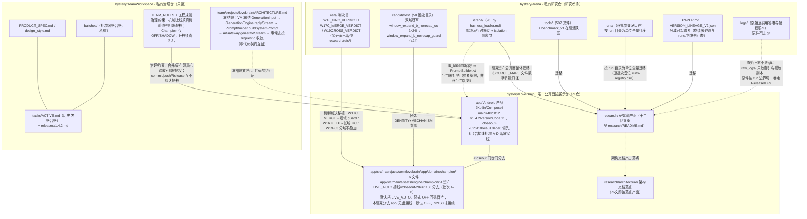
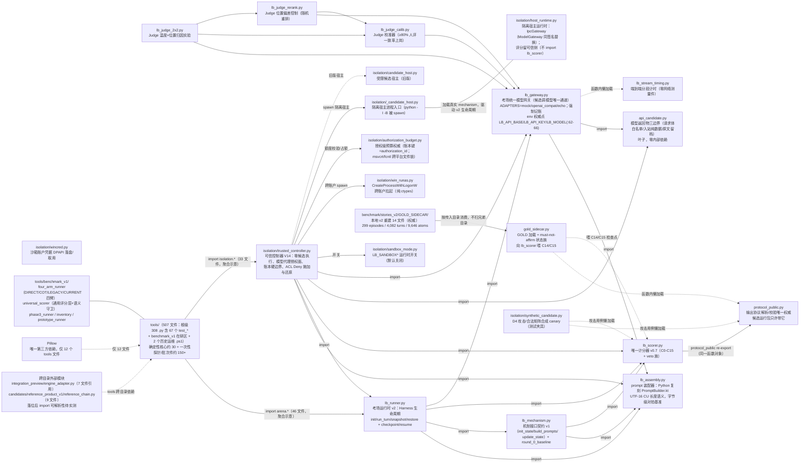

# LoveBrain 架构总览

> **状态：** 正式架构文档（research/architecture/ 第一份，2026-11-12 编制）。面向外部读者：文中全部引用只需本仓（`app/` 与 `research/`）即可核验。
> **证据基准：** 产品树 = `closeout-20261106` 分支 @ `a0104be0` 工作树实测（2026-11-12，porcelain 干净）；研究树 = `research/` 迁移落盘快照（2026-11-12，导览见 [research/README.md](../README.md)）。行号随仓库前移会漂移，引用时以当时实际状态为准。
> **分支状态声明（2026-11-13 复核）：** 本文所述 LIVE_AUTO 接线（§2/§4，commit `afa9559f`→`a0104be0`）实测于 `closeout-20261106` 产品分支。**本文所在的研究分支 `research-migration-20261112` 的 `app/` 代码不含该接线**：`data/SecurePrefs.kt` 的 `championEngineMode` 键不存在时默认读 OFF（:366，fail-closed），`domain/champion/ChampionEngine.kt` 的 `ChampionMode` 枚举仅 OFF/SHADOW/SINGLE_STYLE/FULL（:25-32，无 LIVE_AUTO），且 SINGLE_STYLE/FULL 读写两侧均按 OFF 收敛（S2/S3 未接线）。两分支分叉、互不包含对方新增提交。引用本文接线状态必须带分支名，不得跨分支声称"本分支已集成"。
> **接线状态红线：** 本文严格区分状态——「现状已接线」「已接线（附 commit）」「保持（回退/直通语义不变）」。LIVE_AUTO 生产链路**已在 `closeout-20261106` 分支接线**（guide-6 批次 A-D，commit `afa9559f`→`a0104be0`，2026-11-12 实测）：该分支默认档 LIVE_AUTO，显式 OFF 永远尊重（全链回退原生路径保持），SHADOW 行为不变（§4）。**该状态是 closeout 分支事实，不是本分支事实**（见上方分支状态声明）。不把计划画成已启用，也不把已接线画成待实施。
> **口径与隐私：** 完整性口径 = 文件数 + 字节量（本文化完整性基线见 `research/provenance/SOURCE_MAP.md` §13 数字对账表）；本文零文件哈希值。零真实密钥、零真实聊天内容、零个人数据；API 配置一律占位符（§3 环境变量名为代码事实）。
> **路径基准：** §2 中 `〔domain/PromptBuilder.kt〕` 形式的路径均相对 `app/src/main/java/com/lovebrain/app/`；`research/...` 为本仓相对路径。

---

## 1. 项目三层结构：产品 / 研究 / 治理

LoveBrain 项目由三个仓库构成，角色不互相混淆。**产品仓 `bystery/LoveBrain`**（唯一公开仓库）：Android 聊天辅助产品（Kotlin/Compose，main 分支发布 1.4.2 / versionCode 11），`closeout-20261106` 分支承载机制移植与收口，`research/` 目录承载研究资产公开面；**研究仓 `bystery/arena`**（私有）：研究考场——`arena/` 考场运行时框架 + `isolation/` 隔离包、`tools/` 评测工具、`candidates/` 参赛候选与双域冠军、`runs/` 实验账本、判决书与实验协议，其公开面已按迁移清单整体平移至本仓 `research/` 十二区；**治理仓 `bystery/TeamWorkspace`**（私有，全程只读）：产品规格、工程规则与任务台账，对产品仓的合并与发布施加治理约束（机制上线须真机验收与明确授权）。三者之间的信息流是单向收敛的：产品真实故障族进入研究考场形成实验与判决，只有获得 KEEP/MERGE 判决的机制才向产品移植，移植后以受控档位接入产品（本研究分支当前 SHADOW；`closeout-20261106` 分支已接线 LIVE_AUTO 分域，见卷首分支状态声明），治理仓负责守住合并门槛。下图为三仓库关系与主要迁移/约束边。



---

## 2. 产品生产调用链

**现状主链（OFF/SHADOW/LIVE_AUTO 下已全部接线——接线状态为 `closeout-20261106` 分支 @ `a0104be0` 实测口径；本研究分支 `app/` 无 LIVE_AUTO、默认 OFF，见卷首分支状态声明）：** ViewModel 一次性冻结请求输入 → `GenerationEngine.replyStream` → PromptBuilder 装配 → AiGateway 端口 → DeepSeekRepository 唯一实现 → OpenAiChatWire/CancellableHttpTransport → 上游模型一次流式请求 → 增量解析 → 事件流按 requestId 收敛 → UI 结果区；正式提交点在 `nextRound`（topicRecorder 成功后才入库，事件库只收真实 HER/ME 消息）。SHADOW 为独立影子链：原链路照常生成，冠军引擎并行生成只写 shadow_log，不 emit、不入 UI、不触发提交。图中「分域」部分（prepareLiveContext / GUARD_SHORT / UC_LONG / Guard 主链分支 / 区块注入）为 **LIVE_AUTO 生产接线，已落码已接线（commit `afa9559f`→`a0104be0`）**（§4），节点与边均逐项标注状态。

```mermaid
flowchart TD
    U["用户请求（面板输入/抓取落列表）"]
    VM["LoveBrainViewModel.runReplyRequest():1178<br/>一次性冻结：KB/意图/纠正/仅看本轮/<br/>Provider/revision/资产hash/Champion模式/正式轮次<br/>（快照 :1237/:1239 → buildGenerationInput :1250）<br/>〔viewmodel/LoveBrainViewModel.kt〕〔现状 + 冻结已接线 a0104be0〕"]
    GI["GenerationInput（已冻结）<br/>requestId:26 + providerIdentity:41 + promptAssetHash:43<br/>championMode:49 + committedTurnCount:76<br/>〔model/GenerationInput.kt:24〕<br/>后两字段已接线（VM 冻结传入 a0104be0）"]
    CHK{"分支检查：仅看本轮 / championMode / committedTurnCount<br/>（仅看本轮优先；championMode 分支已接线 61afbc92）"}
    NATIVE["原生 PromptBuilder 装配（现状底座）<br/>仅看本轮走 buildReplyUserPromptOnlyThisRound:315<br/>禁读 Champion 历史<br/>〔domain/PromptBuilder.kt:41〕〔现状〕"]
    PREP["ChampionEngine.prepareLiveContext():245<br/>读唯一 ChampionEventStore；零模型调用；不写事件库；<br/>当前轮消息仅临时输入<br/>〔domain/champion/ChampionEngine.kt:110〕〔已接线 61afbc92〕"]
    EHA["EventHistoryAssembler:22<br/>MAX_EVENT_HISTORY_CU=3600<br/>（UTF-16 CU 完整消息边界，不裸截断）<br/>〔domain/champion/EventHistoryAssembler.kt〕<br/>〔现状：SHADOW/LIVE_AUTO 链路在用〕"]
    STRAT{"按冻结 currentTurn 分域<br/>ChampionTurnStrategy.forTurn:73<br/>GUARD_SHORT / UC_LONG<br/>〔已接线 61afbc92〕"}
    UBD["UncertainBlockDetector:17<br/>UC 块上限 120 CU、最多 3 条，只放当前相关未确认事项<br/>〔domain/champion/UncertainBlockDetector.kt〕<br/>〔已接线：LIVE_AUTO UC_LONG 调用 ChampionEngine:275<br/>（61afbc92 生产可达；SHADOW 装配器保持）〕"]
    PB["PromptBuilder 装配（薄编排器）<br/>buildSystemPrompt:82（安全声明覆盖新区块已接线 replySecurityDeclaration:102）<br/>+ buildReplyUserPromptWithRefs:265<br/>historicalBlock:272 / uncertainBlock:273（已接线 61afbc92）<br/>注入位置＝当前轮聊天记录之前<br/>PromptBudget.byBlocks:30 兼容扩展（已接线 61afbc92）<br/>资产路径唯一出口 AssetRegistry:7"]
    GW["AiGateway.generateStream（端口 :22/:36）<br/>〔domain/port/AiGateway.kt〕〔现状〕"]
    DS["DeepSeekRepository（唯一实现 :46）<br/>〔data/DeepSeekRepository.kt〕〔现状〕"]
    WIRE["OpenAiChatWire（请求体/SSE 协议 :30）<br/>+ CancellableHttpTransport（可取消 HTTP :29）<br/>〔data/OpenAiChatWire.kt / data/CancellableHttpTransport.kt〕〔现状〕"]
    UP["上游模型服务<br/>仅一次流式请求（无 SHADOW 并行、无额外调用）"]
    STREAM["流式回传：ReplyChunk / ReplySchemesArrived<br/>IncrementalSingleObjectScanner 增量解析:237<br/>collectStream 定义 :659<br/>〔domain/GenerationEngine.kt:149〕〔现状〕"]
    GD{"strategy==GUARD_SHORT ?<br/>（已接线分支 61afbc92）"}
    GUARD["ContractGuard.repairAndAudit:784（确定性修复+审计）<br/>FUZZY_MAP_ENABLED=false 保持关闭:65<br/>LIVE_AUTO 短域守卫分支已接线<br/>（GenerationEngine.kt:328，61afbc92；旧档位守卫随生成中途回读一并移除）<br/>〔domain/champion/ContractGuard.kt:45〕"]
    PASS["原文直通（UC_LONG / OFF 不执行 Guard）"]
    PARSE["parseReplyResponse(finalRawText)<br/>（GenerationEngine.kt:394 调用点）〔现状〕"]
    RC["ReplyCompleted:85<br/>修复分流后携带同一份修复文本的解析结果（已接线 61afbc92）<br/>〔model/GenerationEvents.kt〕"]
    CONV["事件流按 requestId 收敛<br/>ReplyRequestState 所有权校验（finally 只清同 id）<br/>→ ReplyVersionStack:58<br/>〔model/ReplyRequestState.kt:17 / feature/reply/ReplyVersionStack.kt〕"]
    UI["UI 结果区（流式状态与最终文本一致；<br/>Guard 改文先 emit ReplyChunkReset/ReplySchemesReset（GenerationEngine:345-346）——已接线 61afbc92）"]
    COMMIT["LoveBrainViewModel.nextRound():1520 正式提交点<br/>topicRecorder.record:1579 成功后读正式轮次<br/>（读取失败 -1 兜底已接线 a0104be0）→ commitConfirmedTurn:1635<br/>〔viewmodel/LoveBrainViewModel.kt / domain/TopicRecorder.kt:53〕"]
    EVT["ChampionEventStore:141 / FileChampionEventStorage:85<br/>仅产品正式提交的 HER/ME 入库；草稿/点赞/采用≠发送；<br/>msgUid 重试去重〔现状〕<br/>〔domain/champion/ChampionEvent.kt〕"]
    DI["AppModule 装配根：FileChampionEventStorage→<br/>ChampionEventStore→ChampionPromptAssembler→ContractGuard<br/>→ChampionEngine；GenerationEngine(getOrNull()) (:102-140)<br/>〔di/AppModule.kt〕〔现状〕"]
    SHNOW["现状注记：mode=SHADOW 且非仅看本轮时<br/>launchShadow fire-and-forget，只写 shadow_log，<br/>不 emit 不入 UI 不触发提交<br/>（GenerationEngine.kt:359-379）"]

    U --> VM --> GI --> CHK
    CHK -->|"OFF / 引擎缺位 / 无有效KB身份 / committedTurnCount=null /<br/>prepareLiveContext 非取消异常 / 仅看本轮"| NATIVE
    CHK -->|"LIVE_AUTO + 正式轮次有效（已接线 61afbc92）"| PREP
    NATIVE --> PB
    PREP --> EHA
    PREP --> STRAT
    EHA -->|"historicalBlock（已接线 61afbc92）"| PB
    STRAT -->|"≤24 GUARD_SHORT：历史块 + 无UC + Guard<br/>（短域判决 W17C MERGE）"| PB
    STRAT -->|">24（≥25）UC_LONG：历史块 + UC + 无Guard<br/>（长域判决 W16 KEEP / W19-03 分域不叠加）"| UBD
    UBD -->|"uncertainBlock（已接线 61afbc92）"| PB
    PB -->|"buildSystemPrompt + buildReplyUserPromptWithRefs"| GW
    GW --> DS --> WIRE --> UP --> STREAM
    STREAM --> GD
    GD -->|"是（≤24，已接线 61afbc92）"| GUARD
    GD -->|"否（UC_LONG / OFF）"| PASS
    GUARD -->|"修改原文时先发 Reset 再交 reducer（已接线 61afbc92）"| PARSE
    PASS --> PARSE
    PARSE --> RC --> CONV --> UI
    VM -->|"用户确认「下一轮」后"| COMMIT
    COMMIT -->|"仅真实 HER/ME、msgUid 去重；<br/>提交失败不回滚产品本轮保存"| EVT
    EVT -.->|"未来轮次 LIVE_AUTO 读取（已接线 61afbc92）"| PREP
    DI -.->|"依赖注入"| VM
    STREAM -.-> SHNOW
```



### 2.1 逐节点文件路径与行号证据

行号为 2026-11-12 `closeout-20261106`@`a0104be0` 工作树实测。路径相对 `app/src/main/java/com/lovebrain/app/`。状态口径：「现状」＝OFF/SHADOW 现状已接线生产行为；「已接线（附 commit）」＝guide-6 批次 A-D 落码并接入生产调用链（`afa9559f`/`61afbc92`/`a0104be0`）；「保持」＝回退/直通语义不变。

| 节点 | 文件 | 行号锚点 | 状态 |
| --- | --- | --- | --- |
| U | —（入口语义） | — | 现状 |
| VM | viewmodel/LoveBrainViewModel.kt | runReplyRequest :1178；冻结快照 :1237/:1239；buildGenerationInput 调用 :1250（championMode/committedTurnCount :1264-1265） | 现状 + 冻结已接线（a0104be0） |
| GI | model/GenerationInput.kt | :24 data class；requestId :26；providerIdentity :41；promptAssetHash :43；championMode :49；KbContext :64；committedTurnCount :76；buildGenerationInput :148（新参 :163-165） | 现状 + 后两字段已接线（a0104be0 冻结传入） |
| CHK | domain/GenerationEngine.kt | 仅看本轮分支 :165；championMode 冻结分流 :163（prepareLiveContextOrNull :428、按冻结 mode 短路 :432） | 已接线（仅看本轮保持 + championMode 分支 61afbc92） |
| NATIVE | domain/PromptBuilder.kt | :41 class；buildReplyUserPromptOnlyThisRound :315 | 现状 |
| PREP | domain/champion/ChampionEngine.kt | :110 class；prepareLiveContext :245（仅看本轮防御返回 null）；生产调用点 GenerationEngine.kt:437 | 已接线（61afbc92） |
| EHA | domain/champion/EventHistoryAssembler.kt | :22 object；MAX_EVENT_HISTORY_CU=3600 :25；budgetHistory :45 | 现状（SHADOW/LIVE_AUTO 链路在用） |
| STRAT | domain/champion/ChampionEngine.kt | ChampionTurnStrategy :61；SHORT_DOMAIN_MAX_TURN=24 :69；forTurn :72-73 | 已接线（61afbc92 分流消费） |
| UBD | domain/champion/UncertainBlockDetector.kt | :17 object；UNCERTAIN_BUDGET_CU=120 :23；MAX_ITEMS=3 :24；buildBlock :224 | 已接线（LIVE_AUTO UC_LONG 调用点 ChampionEngine.kt:275；SHADOW 装配器保持） |
| PB | domain/PromptBuilder.kt + domain/PromptBudget.kt | buildSystemPrompt :82；安全声明覆盖新区块 replySecurityDeclaration :102；buildReplyUserPromptWithRefs :265（historicalBlock :272 / uncertainBlock :273）；byBlocks :30（:38/:39）；AssetRegistry :7 | 已接线（区块扩展 61afbc92） |
| GW | domain/port/AiGateway.kt | :22 interface；generateStream :36 | 现状 |
| DS | data/DeepSeekRepository.kt | :46 class（实现 AiGateway） | 现状 |
| WIRE | data/OpenAiChatWire.kt / data/CancellableHttpTransport.kt | :30 / :29 | 现状 |
| UP | —（上游模型服务） | — | 现状 |
| STREAM | domain/GenerationEngine.kt | replyStream :149；scanner :237；ReplyChunkReset emit :247；collectStream 调用 :253、定义 :659 | 现状 |
| GD | domain/GenerationEngine.kt | 守卫分支 :328-336（GUARD_SHORT 判据；旧档位生成中途回读已删除，登记 :322-323） | 已接线（61afbc92） |
| GUARD | domain/champion/ContractGuard.kt | :45 class；FUZZY_MAP_ENABLED=false :65；repairAndAudit :784 | 类实存 + 主链已接线（61afbc92） |
| PASS | —（直通规则） | UC_LONG / OFF / 仅看本轮无 Guard＝直通事实保持 | 现状（保持） |
| PARSE | domain/GenerationEngine.kt | parseReplyResponse 调用 :394 | 现状 |
| RC | model/GenerationEvents.kt | ReplyChunk :44；ReplyChunkReset :47；ReplySchemesArrived :50；ReplySchemesReset :56；ReplyCompleted :85 | 现状 + 修复分流已接线（61afbc92） |
| CONV | model/ReplyRequestState.kt + feature/reply/ReplyVersionStack.kt | :17 sealed class（requestId finally 所有权校验）/ :58 | 现状 |
| UI | ui/panel/reply/*（ReplyInput/MessageList/CorrectionCenter 等） | 目录实存 | 现状 |
| COMMIT | viewmodel/LoveBrainViewModel.kt + domain/TopicRecorder.kt | nextRound :1520；topicRecorder.record :1579；commitConfirmedTurn 调用 :1635（modeSnapshot :1641；读取失败 -1 兜底登记 :1612）；TopicRecorder :53、record :107 | 已接线（turn 快照 + modeSnapshot，a0104be0） |
| EVT | domain/champion/ChampionEvent.kt | ChampionEvent :37；FileChampionEventStorage :85；ChampionMessage :126；ChampionEventStore :141 | 现状 |
| DI | di/AppModule.kt | champion 装配链 :102-140；GenerationEngine 第三依赖 getOrNull() :140 | 现状 |
| SHNOW | domain/GenerationEngine.kt + domain/champion/ChampionEngine.kt | SHADOW 注释 :359-362；条件 :363-364；launchShadow 调用 :379；launchShadow :194/:443（LIVE_AUTO 恒不进影子，登记 :359） | 现状 |

---

## 3. Arena 研究架构


## 机制研究叙事（公开口径定稿）

> LoveBrain 的 Harness 围绕上下文装配、证据记忆和生成约束三条主线设计。系统首先根据当前意图、场景、话题和持续事项筛选相关信息，再通过完整历史事件和来源身份保留关键证据，并使用未确认事项约束与确定性输出守卫减少事实升级和结构错误。我们将这些机制放入独立 Arena，在固定模型服务下进行连续对话对照和消融，再将有价值的机制移植回 Android 产品。

**不是。Prompt 只是输入的一部分；LoveBrain 还决定记忆如何形成、信息何时注入、旧事实何时失效、当前话题如何切换，以及模型输出如何被确定性处理。**

`research/arena/`（28 个 .py + harness_loader.md，其中 `isolation/` 子包 10 个 .py）是研究考场的运行时框架：**纯标准库、零第三方依赖**（模型调用走 `urllib.request`），Python 3.12（源机实测 3.12.4 全链导入通过）。分层读法自底向上：叶子边界层（请求体白名单 / 输出协议校验 / Gold 侧车）→ 装配与网关（`lb_assembly` / `lb_gateway`）→ 评分（`lb_scorer` 唯一计分器 v0.7）→ 机制契约（`lb_mechanism`）→ 运行时（`lb_runner`）→ Judge 判决实验族（校准 / 重排 / 2×2 归因）→ 隔离包（`isolation/`，可信控制器零候选执行 + 跨账户沙箱）。模块间为平铺导入（`import lb_assembly` 形态）+ `sys.path.insert` 自举；`isolation/` 包要求 arena 目录与 isolation 包同时在 `sys.path`——迁移整体平移，不得拆包。工具面 `research/tools/`（507 文件）为评测/审计/重评分工具与测试；唯一第三方依赖 Pillow 仅 12 个文件使用。题库与 Gold 双轨口径见 `research/benchmark/STATISTICS.md` 与 `research/DATASET_DOCUMENTATION.md` §6（权威 GOLD 侧车 14 文件 / 299 episodes / 4,082 turns / 9,646 atoms）。



### 3.1 组件职责表

路径相对 `research/`。逐文件字节量登记见 `research/provenance/` 迁移清单。

| 组件 | 路径 | 职责 |
| --- | --- | --- |
| 请求边界 | `arena/api_candidate.py` | 模型返回物三边界：出站请求体白名单构造、入站纯数据、原文留档；叶子模块零内部依赖 |
| 协议权威 | `arena/protocol_public.py` | 输出协议解析/校验唯一权威；候选运行包只许携带它 |
| Gold 侧车 | `arena/gold_sidecar.py` | GOLD_SIDECAR 加载与 gold 映射适配（离线零模型调用）；must-not-affirm 状态族；向计分器喂 C14/C15 |
| 输入装配 | `arena/lb_assembly.py` | 回复链路 prompt 装配器：Python 复刻产品 PromptBuilder.kt，UTF-16 code unit 长度语义，字节级对拍基准 |
| 模型网关 | `arena/lb_gateway.py` | 考场统一模型网关（候选调模型唯一通道）；适配器 mock/openai_compat/echo；强制记账；环境变量权威点 LB_API_BASE/LB_API_KEY/LB_MODEL（:62-66），openai_compat 未设 LB_API_BASE 即抛错 |
| 分段计时 | `arena/lb_stream_timing.py` | 端到端分段计时（零网络测量件） |
| 唯一计分器 | `arena/lb_scorer.py` | v0.7（演化 v0.4→v0.7）：C0–C15 检查点 + veto 族；经 protocol_public re-export 同一函数对象。前置代际 `arena/scorer.py`（v3）并存保留、不互相冒充 |
| 机制契约 | `arena/lb_mechanism.py` | 机制层接口契约 v1（init_state/build_prompts/update_state）+ round_0_baseline 基线机制 |
| 考场运行时 | `arena/lb_runner.py` | v2：Harness 生命周期驱动（init/run_turn/snapshot/restore）+ 消毒边界、checkpoint/resume |
| Judge 族 | `arena/lb_judge_calib.py` / `lb_judge_rerank.py` / `lb_judge_2x2.py` | 校准器（20 道人评锚点 + trap 负样本，≥80% 一致率上岗）/ 位置偏差控制（候选随机重排）/ 判决不稳定归因实验（温度×位置 2×2） |
| 隔离包 | `arena/isolation/`（10 .py） | trusted_controller V14：零候选执行、模型代理授权面、账本硬边界、ACL Deny 施加与还原；host_runtime 隔离宿主运行时（IpcGateway 同签名替换，评分留可信侧）；_candidate_host 被 spawn 的进程入口（python -I -B）；candidate_host 旧版宿主；authorization_budget 授权级预算权威（msvcrt/fcntl 文件锁）；sandbox_mode 运行时开关（默认关闭）；win_runas 跨账户拉起（纯 ctypes）；wincred 凭据 DPAPI；synthetic_candidate 攻击/合法矩阵合成 canary（测试夹具） |
| 独立 CLI | `arena/scorer.py`、`init_sandbox.py`、`lb_epgen.py`、`lb_verify_phase0.py`、`lb_vote_sim.py`、`lb_phase05_discrimination.py`、`isolation/wincred.py`（自测） | 不依赖其他 arena 模块（图中不画依赖边） |
| 工具面 | `tools/`（507 文件） | 评测/审计/重评分工具与测试：根级 308 .py（含 67 个 test_*）、benchmark_v1 在研区（four_arm_runner 四臂对照、universal_scorer 通用评分层+语义守卫等）、2 个历史运维 .ps1；确定性可迁核心约 30，一次性探针/批次执行器约 150+ |
| 题库与 Gold | `benchmark/stories_v2/GOLD_SIDECAR/` | 本地 v2 重建 14 文件（权威口径 299/4,082/9,646）；加载按传入目录消费、不扫兄弟目录；三代口径双轨并存见 `research/DATASET_DOCUMENTATION.md` §6 |

运行入口（13 个）与环境变量（含占位符设置方式）见 `research/REPRODUCIBILITY.md` §3/§5；「迁移副本上端到端可运行」待实测清单见同文 §10，本文不重复承诺。

---

## 4. 新增机制接线架构（LIVE_AUTO 分域）

> **状态标注：已落码已接线（commit `afa9559f`→`a0104be0`）：分域 ≤24 GUARD_SHORT / ≥25 UC_LONG，实施=guide-6 批次 A-D——以下全部为 `closeout-20261106` 产品分支状态；本研究分支 `app/` 不含该接线（默认 OFF、无 LIVE_AUTO，见卷首分支状态声明）。**
> 接线批次已收口（2026-11-12）：LIVE_AUTO 进生产链，默认档 LIVE_AUTO（键未写入哨兵默认；显式 OFF 永远尊重＝全链回退原生路径保持），SHADOW 行为不变。分域口径红线：≤24 轮 → guard（短域判决 W17C MERGE）；≥25 轮 → uc（长域判决 W16 KEEP；W19-03 分域不叠加）；两域不同时启用 UC 与 Guard，不宣布单一全域冠军，不得以任何形式变相启用未晋升的合并候选。

**现状基线（2026-11-12 @ `a0104be0` 实测）：** guide-6 批次 A-D 已落码已接线（commit `afa9559f`→`a0104be0`），生产调用点齐备（下表逐项登记）。以下机制单元已存在于产品树：

| 接线要素 | 状态 | 证据（行号 2026-11-12 实测） |
| --- | --- | --- |
| GenerationInput.championMode / KbContext.committedTurnCount / buildGenerationInput 兼容新参 | 已接线（VM 冻结传入，a0104be0） | model/GenerationInput.kt:49 / :76 / :163-165；LoveBrainViewModel.kt:1237 / :1239 / :1264-1265 |
| ChampionMode.LIVE_AUTO（fromRaw 识别；isMainPathGuarded 不认 LIVE_AUTO，旧档位语义不被偷换） | 已接线 | domain/champion/ChampionEngine.kt:41 / :45 / :49 |
| ChampionTurnStrategy：GUARD_SHORT/UC_LONG；SHORT_DOMAIN_MAX_TURN=24 单点定义；forTurn 纯确定性分域 | 已接线（61afbc92 分流消费） | ChampionEngine.kt:61-73；GenerationEngine.kt:328 |
| ChampionLiveContext（currentTurn/strategy/historyBlock/uncertainBlock/historyCu/uncertainCu） | 已接线 | ChampionEngine.kt:81；GenerationEngine.kt:163 消费 |
| prepareLiveContext：读唯一事件库 → 历史块 3600 CU 整条预算 → 当前轮仅临时输入（不 append/不落盘/不入 shadow_log）→ forTurn → 仅 UC_LONG 调 UC 检测；零模型调用；不启动协程/SHADOW | 已接线（生产调用点 61afbc92） | ChampionEngine.kt:245；GenerationEngine.kt:428/:437 |
| commitConfirmedTurn 双轨门禁：modeSnapshot 非空按冻结快照判定（不回读设置）；null 走原 effectiveMode 门禁（原语义不动）；OFF → 零 IO | 已接线（提交点传入，a0104be0） | ChampionEngine.kt:310-324；LoveBrainViewModel.kt:1641 |
| SecurePrefs 默认档 | **默认 LIVE_AUTO**（键不存在 null 哨兵；显式 OFF 永远尊重＝回退保持） | data/SecurePrefs.kt:368-378（:371 默认 "LIVE_AUTO"） |
| PromptBuilder 区块参数 / PromptBudget 扩展 / GenerationEngine 冻结分流 / ViewModel 冻结 / 身份登记重写 | 已接线（61afbc92 / a0104be0） | PromptBuilder.kt:272-273 区块参数、:102 安全声明覆盖新区块；GenerationEngine.kt:163 冻结分流、:172-173 区块传入、:328 守卫分支、:322-323 生成中途回读已删除；LoveBrainViewModel.kt:1237/:1250 冻结；ChampionEngine.kt:596-598 身份登记 default_mode/wired_modes=LIVE_AUTO |

**分域数据流（已接线口径；ViewModel 冻结点已接线 a0104be0）：**

```text
【冻结源：生成开始时各读一次（ViewModel 冻结点=已接线 a0104be0 :1237/:1239）】
LoveBrainViewModel.runReplyRequest
        ├─ championModeSnapshot = championEngine.effectiveMode(kbName, kbName).raw
        └─ committedTurnCountSnapshot = knowledgeRepo.getTurnCount(kbName)（读失败 → null）
        ▼ buildGenerationInput(championMode=…, committedTurnCount=…)
GenerationInput.championMode ─────────────── 分支判据（引擎不回读设置）
KbContext.committedTurnCount ─┬─ 分域环：currentTurn = committedTurnCount + 1（请求轮次）
                              │    └─ ChampionTurnStrategy.forTurn(currentTurn)
                              │          ≤24 → GUARD_SHORT（历史块 + 无 UC + Guard 修复）
                              │          ≥25 → UC_LONG（历史块 + UC 块 + 无 Guard）
                              └─ selector 环：buildReplyUserPromptWithRefs(currentTurn =
                                   committedTurnCount 原值，不加 1；selector 口径=已提交轮数）
禁止作轮次源：dialogue.size / events().size / eventStore.nextTurn() 等
（一轮可含多条 HER/ME 消息，正式轮数只 +1）
```

**机制语义（三条分域机制，均复用既有已落码单元）：**

1. **证据优先的真实历史消息**：`EventHistoryAssembler.budgetHistory` 以 3600 CU（UTF-16 code unit）从最新往旧整条累加，完整消息边界、不裸截断、不 recap、不按相关性重排；当前轮消息按 msgUid 排除防重试重复计入；历史块文本为空时恒空串（无内容不出空标题）；两条分域策略都注入，注入位置＝当前轮聊天记录之前。
2. **未确认事项约束 UC（仅 ≥25 轮）**：`UncertainBlockDetector`（上限 120 CU、最多 3 条、逐字引用、不在场不注入）；GUARD_SHORT 分支恒空串。反面结论约束：合并候选在长域产生过空回复与方向翻转，故不得把 UC 扩展进短域、也不得在长域加 Guard。
3. **ContractGuard 契约修复（仅 ≤24 轮）**：`repairAndAudit`（确定性结构修复 + 审计），`FUZZY_MAP_ENABLED` 保持 false；修改原文时先 emit ReplyChunkReset/ReplySchemesReset 再交 reducer，最终 ReplyCompleted 携带同一份修复后文本的解析结果；Guard 异常或未修改一律保留原文，解析失败语义不变。

**回退与安全边界（已接线实现保证；显式 OFF / 仅看本轮回退保持）：** 显式 OFF 全链短路（不装配、不读库、不修文、不影子、提交零 IO）；`committedTurnCount=null` 不猜轮次、整链回退原生路径；「仅看本轮」为第一判据，跳过 prepareLiveContext/事件库/两块/Guard/SHADOW，仍只发一次模型请求；辅助机制故障绝不拖垮产品回复；历史/UC 两块在超预算时整块保留或整块移除，禁止裸截断；SHADOW 语义零改动，LIVE_AUTO 分支不调用 launchShadow。

---

## 5. 图与文件一致性核对表

本表对三张图中全部节点做文件存在性与行号实测核对（2026-11-12；产品树 `a0104be0` 工作树、研究树迁移落盘快照；只读方法 = ls 文件存在性 + grep 符号定位）。状态口径：**A**=产品树实存（本仓 app/）；**W**=已接线（guide-6 批次 A-D，commit `afa9559f`/`61afbc92`/`a0104be0`；编制时的 K=已落码·未接线、W=接线待实施 两态经批次收口已全部转为已接线）；**R**=研究树实存（本仓 research/）；**T**=治理仓实存（私有，最小读取）；**S**=源研究仓实存（私有）；**X**=外部服务/入口语义。

### 5.1 图（产品生产调用链，§2）

图① 26 节点：其中 3 个为语义/规则节点（U 入口、UP 上游服务、PASS 直通规则），CHK/STRAT/GD 为复用上述文件的判据节点；产品侧 20 个具名文件 **20/20 实存**（UI 节点为 `ui/panel/reply/*` 目录级引用），行号锚点全部为当日 grep 实测；6 处「类实存+接线」标注已随批次 A-D 全部转**已接线**（PREP/STRAT=61afbc92 生产调用；PB 区块扩展、GD 主链分支（含 GUARD）、GI 消费侧、CHK championMode 分支=61afbc92/a0104be0），无一虚构路径。代表行抽查：`ChampionEngine.kt:110` class、`:245` prepareLiveContext、`GenerationEngine.kt:149` replyStream、`:394` parseReplyResponse 调用、`:659` collectStream 定义、`SecurePrefs.kt:371` 默认 "LIVE_AUTO"——全数命中。

### 5.2 图（Arena 研究架构，§3）

| 节点组 | 路径 | 状态 | 实测证据（2026-11-12 ls） |
| --- | --- | --- | --- |
| APIC/PP/GSC/ASM/AGW/STIM/ASC/MECH/ARUN/JC/JR/J22 + scorer 等 | `research/arena/` 根级 18 .py + harness_loader.md | R | ls 实存：根级 20 项（18 .py + 1 md + isolation 目录），isolation/ 内 10 .py，合计 28 .py + 1 md |
| isolation 包（TC/HR/CH/CHOLD/AB/SM/WR/WC/SYN） | `research/arena/isolation/` | R | ls 实存 10 .py |
| TOOLS/BM | `research/tools/`（507 文件）、`tools/benchmark_v1/` | R | find 实测：总 507 文件、根级 308 .py（含 67 个 test_*）、benchmark_v1 下 54 .py、2 .ps1 |
| EXT | `integration_preview/engine_adapter.py` / `candidates/reference_product_v1/reference_chain.py`（源形态） | R（引用方落位后 import 可解析性待实测） | 引用计数 7/9 文件（静态盘点口径）；`research/REPRODUCIBILITY.md` §10（T3）已登记待实测 |
| PIL | 12 个 tools 文件使用 | R | 静态盘点口径；零第三方依赖声明仅指 `arena/` 本体 |
| GLD | `research/benchmark/stories_v2/GOLD_SIDECAR/` | R | ls 实测 14 文件 |

导入链实测口径：源仓库 Python 3.12.4 `-B -I` 全链导入通过（含 universal_scorer）；迁移副本导入可运行性属待实测清单（`research/REPRODUCIBILITY.md` §10，T1/T8），本文不声称迁移副本已实测。

### 5.3 图（三仓库关系，§1）

| 节点组 | 路径 | 状态 | 实测证据 |
| --- | --- | --- | --- |
| A_CORE/A_TOOLS/A_CAND/A_REFS/A_PAPER/A_RUNS/A_LOGS | 源研究仓对应目录 | S | 源仓实存（迁移底稿核对）；公开面落位研究树：`research/arena/`、`research/tools/`、`research/candidates/`（双冠军目录 ls 实存）、`research/refs/experiment_protocol_20261023/long_probe_20261030/`（W16_UNC_VERDICT_20261102.md / W17C_MERGE_VERDICT_20261103.md / W19CROSS_VERDICT_20261103.md 三判决文件 grep 实存）、`research/PAPER.md`、`research/experiments/`（runs/ + runs-registry.csv + raw_logs/ + isolated_runs/ 实存） |
| L_APP/L_CHAMP/L_RES/L_ARCHDOC | 本仓 app/、research/ | A/R | git 基线（closeout-20261106 @ a0104be0，领先 main 8）；champion 6 文件 + assets 4 资产逐文件实存；research/ 十二区实存；architecture/ 本文即落点 |
| T_ARCH/T_RULES/T_SPEC/T_ACTIVE/T_BATCH | 治理仓 team/projects/lovebrain/ | T | 实存（ARCHITECTURE.md 191 行，L130 冻结链原文定向实读；其余按最小化读取纪律只做存在性确认） |

### 5.4 数字差与行号漂移登记

1. **接线批次行号漂移：** 批次 A（冻结输入 + LIVE_AUTO 确定性内核，commit `afa9559f`，+398/-14 于 ChampionEngine.kt / GenerationInput.kt / ChampionEngineTest.kt）使两文件行号相对更早快照整体下移（如 `enum class ChampionMode` :25→:27、`class ChampionEngine` :57→:110、`commitConfirmedTurn` :188→:310）；批次 B/C（生产链路接线，commit `61afbc92`，+1073/-79 共 8 文件）使 `replyStream` :146→:149、`buildReplyUserPromptWithRefs` :227→:265、`collectStream` 定义 :590→:659；批次 D（ViewModel 冻结 + 默认档，commit `a0104be0`，+271/-45 共 9 文件）使 `nextRound` :1492→:1520、SecurePrefs 默认档 :366→:371。本文一律以 2026-11-12 @ `a0104be0` 实测为准。
2. **治理仓冻结链行号漂移：** 治理仓架构契约文档（T_ARCH）所引 `replyStream` :136 / `buildSystemPrompt` :75 为其编写时快照，当前实测 :146 / :82；冻结链语义不变，行号漂移如实登记，不改对方文档。
3. **arena .py 计数：** 早期材料曾有「根级 20 个 / 全部 31 个」的登记；实测（2026-11-12 ls）= 根级 18 .py + isolation/ 10 .py = 28 .py + harness_loader.md，与 `research/provenance/SOURCE_MAP.md` §13 J 行的 29 文件口径一致。以实测为准。
4. **tools 布局：** 67 个 test_* 当前实际平铺于 `research/tools/` 根级（"归 tests/ 子目录"为整理计划，非现状布局）；本文 §3 图节点按实测布局表述。
5. **runs 批次计数：** 以 `research/experiments/runs-registry.csv` 逐批次登记为准；源侧另有批次级登记口径，本文图中不写具体计数以免漂移。
6. **数据集权威口径：** 299 episodes / 4,082 turns / 9,646 atoms（GOLD 覆盖）与 248 custody 注册等，以 `research/benchmark/STATISTICS.md` §一 权威口径链为权威，本文直接引用不另算。

---

## 6. 文档纪律（公开门面）

1. **面向外部读者：** 本文全部引用只需本仓可解析——产品代码（`app/`，行号锚点）、研究资产（`research/`，相对路径）、判决文件（`research/refs/` 落位的 W 系列判决书，文件名即引用）。
2. **零内部编号、零 worker 流水账：** 不携带内部任务台账、执行日志、临时产物与单元编号；唯一的跨文档编号引用是 §4 的接线实施计划口径（guide-6 批次 A–D 状态标注），因为接线状态必须可追溯到实施依据，否则"接线状态"无从核验。除此之外的状态判断全部落在代码 grep 与文件实测上。
3. **状态红线（不把计划画成已启用）：** 全文状态标注「现状已接线 / 已接线（附 commit）/ 保持（回退/直通语义不变）」；LIVE_AUTO 生产链路已随 guide-6 批次 A-D 收口接线（commit `afa9559f`→`a0104be0`，2026-11-12 实测，**`closeout-20261106` 分支状态；本研究分支不含该接线，见卷首分支状态声明**），收口前的「已落码·未接线 / 接线待实施」标注已全部转为已接线、不再出现；SHADOW≠主链路启用；SINGLE_STYLE/FULL 按 OFF 收敛；分域冠军是分域的，不是全域的。
4. **零隐私：** 零真实密钥、零真实聊天内容、零个人数据、零签名材料；API 配置只出现环境变量名与占位符语义；私有治理仓内容只作角色与约束级描述，不引用台账细节；原始日志原件不进 git（索引与脱敏副本落 `research/experiments/raw_logs/`，原件走 Release/LFS 十卷）。
5. **完整性口径：** 文件数 + 字节量（`research/provenance/SOURCE_MAP.md` §13 数字对账表与 `research/provenance/MIGRATION_MANIFEST.csv`）；本文不含任何文件哈希值。
6. **Mermaid 语法纪律：** 节点 id 全 ASCII 字母开头、仅字母数字下划线；含中文/括号/冒号/比较符的标签一律双引号包裹，换行用 `<br/>`；路径标注统一正斜杠；subgraph 用 `subgraph ID["标题"]` 带引号形式且 id 唯一（本文 §1 图 RA/RL/RT）；不使用 classDef/style（避免渲染器差异），现状/计划区分由标签文字承载。三图已按此纪律做机械自检（id 合法性、保留字、声明/引用闭合、块内唯一性），自检通过记录见随附核对报告。

*证据时效：本文全部行号/文件数取自 2026-11-12 实测（产品树 closeout-20261106@a0104be0 干净工作树、研究树迁移落盘快照）；仓库前移后引用需重核。*
