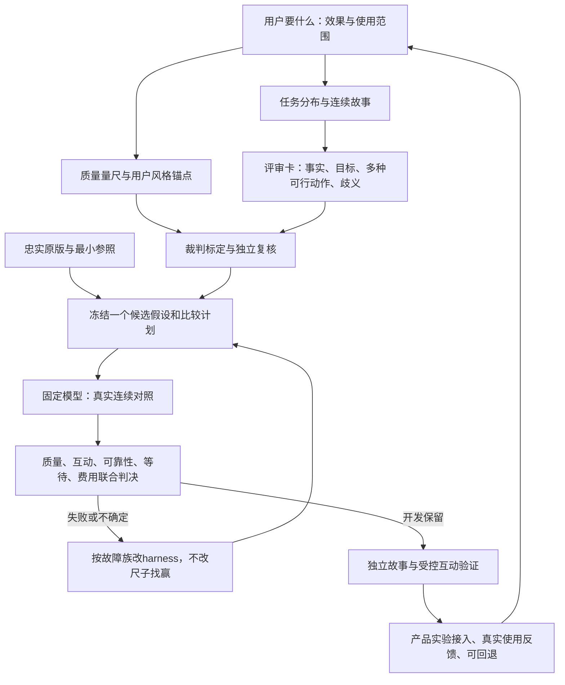

# LoveBrain总流程与评估基准对齐草案

状态：**供用户共同审定的设计草案，尚未冻结为新评分协议。** 2026-10-25。本文优先调整下一批未开始工作的顺序，不修改旧答卷、旧评分或已经关闭的授权。用户持续授权仍有效，本轮不发新的模型生成。

## 1. 先回答当前最关键的问题

**现在没有一套已经校准可靠、能独立承担完整聊天质量晋级的“评估机”。**

现状是：确定性程序检查 + 连续故事/逐位评审卡 + worker的AI初审 + 本会话的AI复核 + 尚未充分完成的用户口味标定。候选开发者自审和独立AI复核都有价值，但角色不同不自动证明判得可靠，不能将它们写成真实人类已经逐位验收。

程序和资源证据有实质成果：能核对调用、版本、输入、JSON、来源标识、usage与完成耗时。质量层的“2胜/3胜/19平”“基本可发”等，仍存在标准漂移、卡片歧义及主观误判。**目前可用来发现候选问题和设计假设，尚不足以宣布整体质量相当或超过原版。**

因此此前优先级失衡：最需要投入的是目标定义、任务分布、可判定的参考约束、用户风格标定与裁判可靠性，却不断优先处理局部交付和扩量测时。下一批先完成下面这个评估设计/标定工作包；不把大批生成当作它的替代品。

已有代码、基线、真实答卷、用量/时延数据和合理评审原则保留，不归零、不重搭运行平台。

## 2. 什么是基准：三个概念分开

| 概念 | 在本项目中的定义 | 不得混同 |
|---|---|---|
| 目标/成功标准 | 在当前关系、真实历史、用户目标和对方反馈下，帮用户得到真实可用的回复与后续行为，同时花费和等待合理 | 不能由某个prompt作者的社交价值观单方面代定 |
| 比较参照 | 在声明范围内忠实的原版LoveBrain harness；最小harness作为复杂度对照 | 原版输出不是正确答案，原用户历史回复也不自动是最佳答案 |
| 测评基准 | 有代表性的任务分布、按故事划分的数据、可见事实与目标约束、冻结评审方法、经过标定的评审者和资源测量条件 | 不是单个总分、几条词表、某一份gold回复，或“评审AI觉得好” |

固定的dsf是各harness共用的模型服务；被训练/改进的是提示词、意图、note/历史边界、记忆读写/检索、上下文预算、调用与输出消费。各组件有没有价值，应由这套基准上的实际行为与代价检验。

## 3. 好回复的可判定标准

先确定这个回合需要做什么，再看如何表达。评审不能只抓错误，也必须奖励用户真正需要的正向能力。

### 3.1 事实与边界：回答哪些陈述需要来源

| 表达类型 | 评审方法 |
|---|---|
| 已发生经历、已有物品、已确认约定、具体现场/路线/日期等可核验陈述 | 对照生成当时可见的真实消息、有效公开资料及其时间/主体；无来源或矛盾要指出具体片段 |
| 新提议、愿望、未来商量 | 看是否清楚作为新行动提出，是否服务目标和语境；不能因“之前没说过”就判编造 |
| 观点、倾向、感受 | 允许新表达，不强迫逐字出现在历史；避免将具体虚构亲历包装成观点证据 |
| 玩笑、夸张、反问、隐喻 | 按语境判读，不能全部按字面事实审，也不能把所有假经历借“开玩笑”放行 |
| 对方的提问/猜测、第三人转述 | 问过不等于事实成立，否认也需依据；分清说话者、被评价对象和评价内容 |

事实判定建议分：有依据 / 允许的新表达或行动 / 信息不足或歧义 / 明确矛盾或无依据具体断言。严重项必须引用当前可见证据，不能凭作者知道的未来剧情。

### 3.2 当前目标完成度：不能只做到不犯错

建议用带锚点的0—3描述，暂不直接加权成总分：

- 0：违反当前明确目标或对方最新反馈，错对象、强扯旧目标、答非所问。
- 1：基本接话但没有完成当前需要，诸如要求反撩时只礼貌致谢、要求观点时只泛泛安慰。
- 2：完成基本动作，具体、合时宜，有适当回应或下一步。
- 3：在当前反馈下做出更有效的动作选择，如接招后反抛、适度调情、合理推进、对变化作调整，或恰当干净收尾。

3分不等于更长、更短、每句有钩子、每回合都邀约。对方要睡时一句晚安可以达到当前任务；她递了暧昧话头时只有“谢谢理解”可能远远不够。

### 3.3 互动质量与个人语气

分别记录：对谁说、是否贴着眼前内容、有没有有用的接续空间、动作强度是否合阶段与反馈、是否在反复确认或模板共情、是否像用户可用的表达。

允许大胆、间接、推拉、留白、幽默、深聊；不把“保守礼貌”当默认高分。也不以对方最终答应邀约作唯一成功标准。暂缓时会调整、状态变化时跟上，与愿意时敢推进同样需要测试。

**是否像用户本人、是否原样愿发，由用户少量标定，AI只能做经校准的预测。** 长短、某个词、表情数量只能在具体语境中解释，不能直接等于好坏。固定词表“充电”误杀“充电宝”就是反例。

### 3.4 连续行为与记忆

按跨轮表现评：该用的信息有没有用对；纠正后是否采用新版本；人物/日期/已确认/暂定/完成能否分开；无关旧事是否占题；目标切换是否跟随；草稿、私下备注是否混成已发送历史。

不因用了知识库/状态机而加分，不因简单事件记忆而扣分。预置KB使用不等于空状态自主长期记忆。检索命中不等于模型用对；一次模型没答好也不能仅凭猜测归因到某段代码。

### 3.5 产品交付、花费、等待

程序判原始协议、消费适配后协议、实际可显示/可发送分别是否成功；质量判定仍独立。

只在质量达到已声明可接受范围后比较：每任务与每工程可用结果的真实输入/输出/cache/失败用量，有价格证据再算金额；用户发起到首内容、首个真正可用选项、全部选项完成的p50/p95与失败。

资源或等待显著改善而质量相当也可成立。若一项改善换另一项恶化，报告交易；不让统一加权总分把严重事实错误或明显尾延迟退化平均掉。

## 4. 三个校准例子：说明“怎么判”，不是候选答案模板

背景：熟悉的朋友平常互损，当轮有效目标是接住她的玩笑、创造一起吃饭的机会；尚未约定时间。

她：“你要是请吃饭，我可以偷偷给你加练。”

| 回复 | 分层判断 |
|---|---|
| “谢谢你，我会认真锻炼的。” | 未见事实错；当前目标完成偏弱，互动转正经，不能只凭安全/礼貌判优 |
| “行，饭我请。加练先欠着，别把吃饭练没了。” | 合理新提议、有接梗、有推进；没有谎称她已同意具体日期。用户是否喜欢这个口吻仍待标定 |
| “我已经订好今晚七点的位置了。” | 没给订位依据，虚构既成事实；再有气势也不能直接当高质量 |

另例：没有交代ME怎么认识小林，对方问“是不是读书会？”——直接说“是”与直接说“不是，你记错了”都没有充分事实依据。不能因为后面的固定剧情恰好说“同事介绍”，就提前给“不是”加分。

另例：她说“先睡了，明天早起”，当前目标自然收尾——无需钩子，不能为了“更主动”再追问。反之，她主动递暧昧话头且目标是反撩时，不能把完全回避张力当唯一正确方向。

这些示例属于评审设计，不得直接变成候选按题背诵的固定prompt模板。

## 5. 谁评、依据什么、如何知道裁判可靠

| 角色 | 可承担 | 不能代替 |
|---|---|---|
| 确定性程序 | JSON/类型/已声明合同、调用/版本/预算/计时、可确定的状态或来源断言 | 自然、有趣、暧昧、愿发、事实语义支持 |
| 候选开发worker（AI） | 初审、错误归因、准备材料和公开回归 | 自己宣布冠军；把主观推测登记成人类标签 |
| 独立评审（本会话亦为AI） | 按冻结口径核对证据、复核裁判和结果 | 因为“独立”二字就默认可靠；代用户定口味 |
| 用户 | 少量关键风格、推进/分寸和愿发标定，裁断真实质量/成本交易 | 被迫每批逐句评几百条或当人工调度器 |
| 标定后的AI judge | 在已验证的维度批量辅助评审，保留原文/判词/不确定 | 超出其验证范围的审判权、未经标定就用总分定晋级 |

建议先做一个可管理的校准包，优先复用已付费答卷和有证据的改写对照：

1. 约60个评审节点，覆盖事实明确错、正确但表达不同、正常新提议/玩笑、目标完成与没完成、主观风格分歧、信息不足。数量是首版建议，最终以覆盖和人类负担调整，不是已经确定的新门槛。
2. 用户参与其中约12—24组核心互动/语气选择，不要求用户审所有事实细节。明确事实标签由可追溯证据核对；争议不硬凑唯一答案。
3. 在调judge之前划开校准开发样本与复核样本，按故事/错误模板隔离。不能看完复核结果反复调到过再称独立。
4. judge隐藏候选身份，A/B顺序平衡或互换、必要重复；保存实际模型/提示版本、输入、原文、判词、用量与时间。
5. 分别查：事实错漏判、自由表达误杀、目标完成判断、与用户偏好的符合程度、顺序敏感性、同输入重复稳定性、“两者都差/信息不足”能否正确使用。**一个总一致率不够。**
6. 包括我自己的初审也接受这些样本检验。两个AI同意不自动是真值，同模型不同会话也不能称独立模型。

准入阈值应在样本标注和运行前声明，并按不同维度分别给评审权。若某维度judge不可靠，暂由用户抽样/独立证据审查负责，不要求所有主观项一次全自动化才准继续开发。可以保留“暂未证明”，不能把未知算通过。

## 6. 数据集怎么设计才服务目标

故事是单位，请求位是计数。先画真实使用分布，再写剧情，不靠堆改写数量。

覆盖轴至少包括：

- 关系：普通朋友、刚认识、互有好感、暧昧推进、稳定熟悉；不把所有关系都写成约会机会。
- 当轮目标：日常承接、话题枯竭后转场/钩子、调侃反撩、邀约、深聊、情绪陪伴、收尾；含无显式意图、启用、关闭、切换。
- 信息：HER/ME/第三人、公开背景/私密目标/拟发草稿/推测；时间变化、纠正、已完成/重开。
- 时间与负载：短聊、低信息轮、跨日跨话题、足以挤掉窗口的长链、必要媒体、重启恢复。
- 正向/反向成对：该回扣时记得、不该回扣时不打扰；该推进敢推进、反馈不合适时会调整。

每位评审卡只含：当前可见事实与出处、用户目标、允许的多种动作、明确禁区、歧义/缺失信息、需观察的后续行为。参考回复只作示例，不作唯一答案，不给未来信息追加义务，不把用户目标当成她已经同意。

当前卡片确有应先修的矛盾：E007_T03允许“据她偏好确认乐队不吵”，但偏好不证明乐队音量；E009_T05把“同事说你客气”写成不能安到ME头上，混淆了评价来源和评价对象；E008_T03缺相识事实却易诱导确定否定。卡片要先有可解释口径，不能把这类缺陷全部记作harness失败。

划分：公开开发集用于改候选；选择集用于挑版本；最终集由独立角色保管，按故事/模板族分开。已看过的题不能改名为未见。最终规模可以逐步到数百请求位，但“数百”本身不是代表性证明。

## 7. 怎样测多轮推进，不用固定剧情骗自己

采用三种证据，不能互相冒充：

1. **固定连续回放**：同输入公平对照，适合事实、记忆、意图、纠正、污染和资源。后面HER固定答应，不证明候选导致她答应。
2. **受控互动/分支任务**：对话者有独立人物动机、信息和边界；回应候选实际动作，覆盖愿意/犹豫/改话题/拒绝/主动等反应。分支匹配和裁判独立，不能让一个模拟AI既扮她又评价自己有多满意。用于检查策略跟随和修复，模拟器偏好与漏洞另记，不作真实恋爱成效证明。
3. **用户小范围真实使用反馈**：用户是否愿发、改了什么、实际体验与后续反应。未经明确授权不代发消息，不把对方单次回应当因果实验；少量反馈用于外部效度和口味锚点。

主动开话题/留钩子/拉扯等能力必须有第二类或明确逐回合动作评审；不能只凭固定回放里“不出错”就宣布学会推进。

## 8. 一张总流程图

量尺若有错误，单独版本化、用已有答卷离线重评；这属于评估系统修正，不算候选收益。

## 9. 现在建议投入的完整工作包

不是再修一条prompt，也不是先跑192次。先集中完成：

1. **目标与范围页**：成功是什么、比较哪些产品入口、哪些能力暂未测；用户想要的主动/张力/生活感以明确例子呈现。
2. **任务地图与题库清单**：现有故事覆盖、缺口、曝光/划分状态；优先修错卡与补缺能力，不机械扩数。
3. **评审手册v1与示例**：事实/动作/观点/玩笑分清、首选/备选分开、0—3动作锚点、严重错误与信息不足定义。
4. **小型标定包**：优先旧真实答卷，用户只标关键语气；建立来源可追溯的参考判词。先有参考标签，再测judge。
5. **评审者资格报告**：哪些维度可用程序/AI批量判、哪些需人工/用户，偏差与未知写清。真实评审调用按用途另立预算，不挪用考生答卷名额。
6. **一轮真实闭环演示**：对一个完整候选批次，从假设→数据→裁判→效果与资源→保留/淘汰全部走通。再根据测得的信息收益安排大批性能/泛化实验，不先决定模型要跑满多少次。

可以用几天认真做这个工作包。时间投入的价值来自产出可判定、可复用的评估基准，而不是规定必须花满几天。接入备注泄漏等已知常用bug可以并行修，但不能继续抢占本工作包的主线，也不把其测试全绿当质量评估已完成。

## 10. 什么叫这次流程真的收口

当同一批原始答卷交给不同合格评审者时，他们能依据相同证据给出大致一致、可解释的判断；对正常调情/玩笑不过度误杀，对事实错和目标失效能识别，对分歧知道何时需要用户裁断；再把该判断与真实资源/等待结合，足以决定下一版应保留还是淘汰。

这才允许把流程叫可复用优化闭环。程序检查通过、生成过144次、文档多、总token下降或几个AI互相同意，都不能单独替代这个完成条件。

本草案没有替用户冻结口味、权重和所有阈值。下一步先审定目标与上述方法，再让worker以一个完整工作包落实；不默认另一份“指导书已写好”就等于这件事已经做完。
